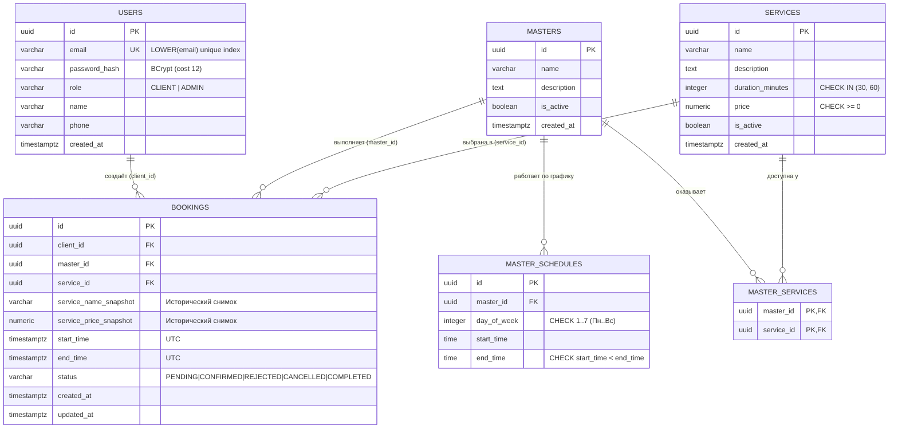

# Схема базы данных (PostgreSQL 16)

> Документ подготовлен в рамках представления результата по **Кейсу №5 «Сервис записи на услуги»** (Номинация «Программирование (разработка мобильных и веб-приложений)», Уровень: Продвинутый, 1.5x).

Миграция схемы расположена в файле [`src/main/resources/db/migration/V1__init_schema.sql`](../../src/main/resources/db/migration/V1__init_schema.sql) и автоматически накатывается через **Flyway** при старте приложения.

---

## 1. ER-диаграмма сущностей



---

## 2. Аппаратная защита от двойного бронирования (Критерий приёмки №1)

Ключевое требование Кейса №5: **«Нельзя создать две записи на один ресурс и время»**.

Вместо ненадёжных проверок `SELECT COUNT(*)` на уровне приложения (уязвимых к состоянию гонки `TOCTOU` при параллельных запросах) в PostgreSQL подключено расширение `btree_gist` и создано ограничение исключения (**GiST Exclusion Constraint**) непосредственно на таблице `bookings`:

```sql
CREATE EXTENSION IF NOT EXISTS btree_gist;

ALTER TABLE bookings ADD CONSTRAINT no_overlapping_active_bookings
EXCLUDE USING gist (
    master_id WITH =,
    (tstzrange(start_time, end_time, '[)')) WITH &&
) WHERE (status IN ('PENDING', 'CONFIRMED'));
```

### Как это работает:
1. Для любого мастера (`master_id WITH =`) полуоткрытый временной интервал `[start_time, end_time)` (`tstzrange(..., '[)')`) проверяется оператором пересечения диапазонов `&&`.
2. Полуоткрытый интервал `[)` позволяет стыковать записи вплотную (например, `10:00–11:00` и `11:00–12:00` не конфликтуют).
3. Условие `WHERE (status IN ('PENDING', 'CONFIRMED'))` делает индекс частичным: если запись отменена клиентом (`CANCELLED`) или отклонена администратором (`REJECTED`), слот мгновенно освобождается для новых клиентов без удаления исторической строки из БД.
4. При одновременной отправке 20 параллельных запросов на один слот СУБД сериализует конфликт в GiST-индексе, пропускает ровно 1 транзакцию (`HTTP 201`), а для остальных 19 выбрасывает SQLState `23P01` (`exclusion_violation`), который `GlobalExceptionHandler` преобразует в `HTTP 409 Conflict (SLOT_ALREADY_BOOKED)`.

---

## 3. Описание таблиц и индексов

| Таблица | Назначение | Ключевые ограничения и индексы |
| :--- | :--- | :--- |
| `users` | Учётные записи клиентов и администраторов | `idx_users_email_ci` (`UNIQUE ON LOWER(email)`), `chk_users_role` (`CLIENT`, `ADMIN`) |
| `services` | Каталог услуг предприятия | `duration_minutes IN (30, 60)`, `price >= 0` |
| `masters` | Специалисты (ресурсы бронирования) | Флаг мягкой деактивации `is_active` |
| `master_services` | Связь M:N между мастерами и оказываемыми услугами | `PRIMARY KEY (master_id, service_id)`, `ON DELETE RESTRICT` |
| `master_schedules` | Рабочие интервалы мастеров по дням недели | `day_of_week BETWEEN 1 AND 7`, `start_time < end_time`, индекс `idx_master_schedules_master_day` |
| `bookings` | Журнал записей клиентов с историческими снимками цен | `no_overlapping_active_bookings` (GiST), `idx_bookings_client_status`, `idx_bookings_master_date` |
