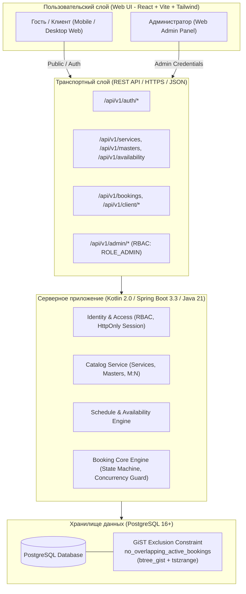
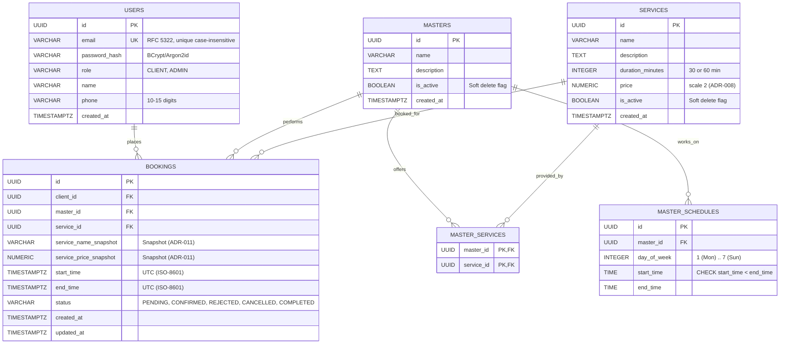
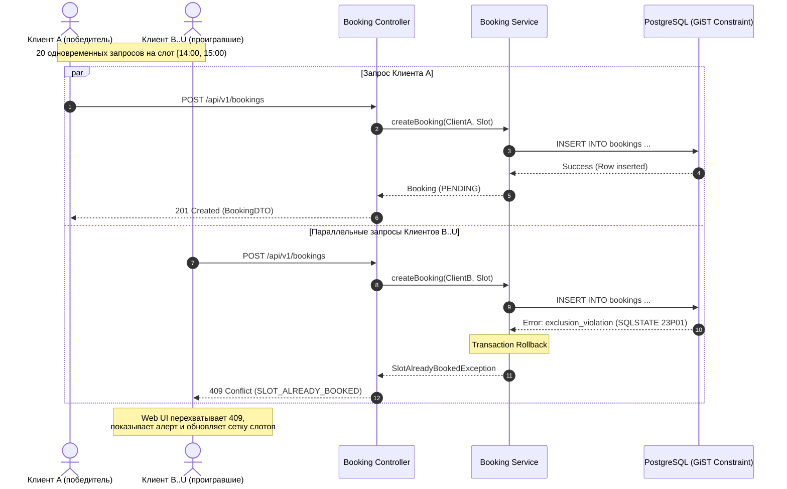

# Архитектурный дизайн системы — Сервис онлайн-записи на услуги (`service-booking`)

- **Case ID:** `service-booking`
- **Версия архитектуры:** `1.0.0-PROPOSED`
- **Дата:** `2026-11-03`
- **Профиль реализации:** `FULL_STACK` (Kotlin/JVM Backend + Web Frontend)
- **Статус:** `PENDING_USER_APPROVAL`

---

## 1. Общий обзор системы и контекст

Система представляет собой единый монолитный сервис (Single-tenant web application) для заведения сферы услуг.
Приложение обслуживает три категории пользователей:
1. **Гости (`ACTOR-001`):** просмотр активного каталога услуг, карточек специалистов (мастеров), расписания свободных слотов.
2. **Клиенты (`ACTOR-002`):** оформление заявок на свободные слоты (`PENDING`), личный кабинет с активными и прошлыми записями, отмена собственных активных записей до наступления времени начала визита.
3. **Администраторы (`ACTOR-003`):** управление услугами (CRUD, мягкая деактивация), управление мастерами (CRUD, связывание с услугами), управление графиком смен, модерация входящих заявок (`CONFIRMED`, `REJECTED`), отмена подтвержденных записей (`CANCELLED`) и завершение визитов (`COMPLETED`).



---

## 2. Архитектура бэкенда (Kotlin/JVM + Spring Boot 3.3)

### 2.1. Модульная структура и границы ответственности
Приложение строится по принципам модульного монолита с разделением на функциональные доменные области (Bounded Contexts) и разделением слоёв (Web/API -> Application/Service -> Domain -> Infrastructure/Persistence):

```text
src/main/kotlin/com/booking/
├── identity/                        # Контекст идентификации и безопасности
│   ├── domain/                      # User, Role, PasswordPolicy
│   ├── application/                 # AuthService, RegisterUseCase, LoginUseCase
│   ├── infrastructure/              # UserRepository, SpringSecurityConfig, SessionManager
│   └── presentation/                # AuthController, AuthDto (RegisterRequest, LoginRequest, UserResponse)
├── catalog/                         # Контекст каталога услуг и мастеров
│   ├── domain/                      # Service, Master, MasterService, Money
│   ├── application/                 # ServiceCatalogService, MasterManagementService
│   ├── infrastructure/              # ServiceRepository, MasterRepository
│   └── presentation/                # PublicCatalogController, AdminCatalogController, CatalogDtos
├── schedule/                        # Контекст рабочего графика и генерации доступности
│   ├── domain/                      # MasterSchedule, TimeRange, WorkingInterval, AvailableSlot
│   ├── application/                 # AvailabilityCalculatorService, MasterScheduleService
│   ├── infrastructure/              # MasterScheduleRepository
│   └── presentation/                # AvailabilityController, AdminScheduleController, ScheduleDtos
├── booking/                         # Ядро бронирования и жизненный цикл визитов
│   ├── domain/                      # Booking, BookingStatus, BookingInvariants
│   ├── application/                 # BookingService, CreateBookingUseCase, CancelBookingUseCase, ModerationUseCase
│   ├── infrastructure/              # BookingRepository, PostgresExclusionTranslator
│   └── presentation/                # ClientBookingController, AdminBookingController, BookingDtos
└── shared/                          # Сквозные механизмы
    ├── config/                      # AppProperties, TimezoneConfig, JacksonConfig
    ├── exception/                   # DomainException, GlobalExceptionHandler, ApiErrorResponse
    └── audit/                       # RequestLoggingFilter, AuditEventLogger
```

### 2.2. Защита архитектурных границ
- Слой `domain` не зависит от фреймворка Spring и внешних библиотек.
- Прямые вызовы между модулями осуществляются строго через Application Services.
- Сущности БД не отдаются напрямую в REST-контроллеры; контроллеры оперируют строгими DTO.

---

## 3. Реляционная модель данных (PostgreSQL)

### 3.1. Диаграмма сущностей (ERD)



### 3.2. DDL Схемы с инвариантом овербукинга

```sql
-- 1. Подключение расширения для btree индексов в GiST
CREATE EXTENSION IF NOT EXISTS btree_gist;

-- 2. Таблица пользователей
CREATE TABLE users (
    id UUID PRIMARY KEY DEFAULT gen_random_uuid(),
    email VARCHAR(255) NOT NULL,
    password_hash VARCHAR(255) NOT NULL,
    role VARCHAR(32) NOT NULL,
    name VARCHAR(100) NOT NULL,
    phone VARCHAR(20) NOT NULL,
    created_at TIMESTAMPTZ NOT NULL DEFAULT CURRENT_TIMESTAMP
);
CREATE UNIQUE INDEX idx_users_email_ci ON users (LOWER(email));

-- 3. Таблица мастеров
CREATE TABLE masters (
    id UUID PRIMARY KEY DEFAULT gen_random_uuid(),
    name VARCHAR(100) NOT NULL,
    description TEXT,
    is_active BOOLEAN NOT NULL DEFAULT TRUE,
    created_at TIMESTAMPTZ NOT NULL DEFAULT CURRENT_TIMESTAMP
);

-- 4. Таблица услуг
CREATE TABLE services (
    id UUID PRIMARY KEY DEFAULT gen_random_uuid(),
    name VARCHAR(100) NOT NULL,
    description TEXT,
    duration_minutes INTEGER NOT NULL CHECK (duration_minutes IN (30, 60)),
    price NUMERIC(10, 2) NOT NULL CHECK (price >= 0),
    is_active BOOLEAN NOT NULL DEFAULT TRUE,
    created_at TIMESTAMPTZ NOT NULL DEFAULT CURRENT_TIMESTAMP
);

-- 5. Связь мастеров и услуг (M:N)
CREATE TABLE master_services (
    master_id UUID NOT NULL REFERENCES masters(id) ON DELETE RESTRICT,
    service_id UUID NOT NULL REFERENCES services(id) ON DELETE RESTRICT,
    PRIMARY KEY (master_id, service_id)
);

-- 6. Рабочее расписание мастеров
CREATE TABLE master_schedules (
    id UUID PRIMARY KEY DEFAULT gen_random_uuid(),
    master_id UUID NOT NULL REFERENCES masters(id) ON DELETE CASCADE,
    day_of_week INTEGER NOT NULL CHECK (day_of_week BETWEEN 1 AND 7),
    start_time TIME NOT NULL,
    end_time TIME NOT NULL,
    CONSTRAINT chk_schedule_interval CHECK (start_time < end_time)
);
CREATE INDEX idx_master_schedules_master_day ON master_schedules(master_id, day_of_week);

-- 7. Таблица бронирований с защитой от овербукинга
CREATE TABLE bookings (
    id UUID PRIMARY KEY DEFAULT gen_random_uuid(),
    client_id UUID NOT NULL REFERENCES users(id) ON DELETE RESTRICT,
    master_id UUID NOT NULL REFERENCES masters(id) ON DELETE RESTRICT,
    service_id UUID NOT NULL REFERENCES services(id) ON DELETE RESTRICT,
    service_name_snapshot VARCHAR(100) NOT NULL,
    service_price_snapshot NUMERIC(10, 2) NOT NULL,
    start_time TIMESTAMPTZ NOT NULL,
    end_time TIMESTAMPTZ NOT NULL,
    status VARCHAR(32) NOT NULL,
    created_at TIMESTAMPTZ NOT NULL DEFAULT CURRENT_TIMESTAMP,
    updated_at TIMESTAMPTZ NOT NULL DEFAULT CURRENT_TIMESTAMP,
    CONSTRAINT chk_booking_time_valid CHECK (start_time < end_time),
    CONSTRAINT chk_booking_status_valid CHECK (status IN ('PENDING', 'CONFIRMED', 'REJECTED', 'CANCELLED', 'COMPLETED'))
);

-- Инвариант: отсутствие пересечений для активных статусов PENDING и CONFIRMED (ADR-004)
ALTER TABLE bookings ADD CONSTRAINT no_overlapping_active_bookings
EXCLUDE USING gist (
    master_id WITH =,
    (tstzrange(start_time, end_time, '[)')) WITH &&
) WHERE (status IN ('PENDING', 'CONFIRMED'));

CREATE INDEX idx_bookings_client_status ON bookings(client_id, status);
CREATE INDEX idx_bookings_master_date ON bookings(master_id, start_time);
```

---

## 4. Конкурентная обработка и защита от овербукинга

### 4.1. Механизм гонки 20 одновременных запросов (`NFR-001`, `AC-003`)



---

## 5. Спецификация REST API-контрактов

### 5.1. Аутентификация и сессия
- `POST /api/v1/auth/register`
  - Request: `{ "email": "client@example.com", "password": "password123", "name": "Иван", "phone": "+79991234567" }`
  - Response 201: `{ "id": "...", "email": "...", "name": "...", "phone": "...", "role": "CLIENT" }` + Cookie `JSESSIONID`
  - Response 400: `VALIDATION_FAILED` (ошибки длины пароля, формата телефона/email)
  - Response 409: `EMAIL_ALREADY_EXISTS` (email уже занят)
- `POST /api/v1/auth/login`
  - Request: `{ "email": "client@example.com", "password": "password123" }`
  - Response 200: `{ "id": "...", "email": "...", "name": "...", "role": "CLIENT" }` + Cookie
  - Response 401: `INVALID_CREDENTIALS`
- `POST /api/v1/auth/logout`
  - Response 200: `{ "status": "LOGGED_OUT" }` (инвалидация на сервере и очистка cookie)
- `GET /api/v1/auth/me`
  - Response 200: текущий пользователь
  - Response 401: `UNAUTHORIZED`

### 5.2. Каталог и доступность слотов
- `GET /api/v1/config` -> `200 OK`:
  ```json
  {
    "timezone": "Europe/Moscow",
    "currency": "RUB"
  }
  ```
- `GET /api/v1/services` -> `200 OK`: `[{ "id": "...", "name": "...", "description": "...", "durationMinutes": 60, "price": 1500.00 }]`
- `GET /api/v1/masters?serviceId={id}` -> `200 OK`: `[{ "id": "...", "name": "...", "description": "..." }]`
- `GET /api/v1/availability?masterId={id}&serviceId={id}&date=YYYY-MM-DD` -> `200 OK`:
  ```json
  [
    {
      "startTime": "2026-11-10T07:00:00Z",
      "endTime": "2026-11-10T08:00:00Z"
    },
    {
      "startTime": "2026-11-10T08:00:00Z",
      "endTime": "2026-11-10T09:00:00Z"
    }
  ]
  ```

### 5.3. Клиентские бронирования
- `POST /api/v1/bookings` (Требует роль `CLIENT`)
  - Request: `{ "masterId": "...", "serviceId": "...", "startTime": "2026-11-10T08:00:00Z" }`
  - Response 201: `{ "id": "...", "status": "PENDING", "serviceName": "...", "price": 1500.00, "startTime": "...", "endTime": "..." }`
  - Response 409: `SLOT_ALREADY_BOOKED`
  - Response 400: `BOOKING_IN_PAST`, `OUTSIDE_WORKING_HOURS`
- `GET /api/v1/client/bookings` (Требует роль `CLIENT`)
  - Response 200: `{ "active": [...], "archive": [...] }`
- `POST /api/v1/client/bookings/{id}/cancel` (Требует роль `CLIENT`, проверка владельца)
  - Response 200: `{ "id": "...", "status": "CANCELLED" }`
  - Response 400: `CANCELLATION_DEADLINE_EXCEEDED` (если время визита уже наступило)
  - Response 403: `ACCESS_DENIED` (попытка отменить чужую запись)

### 5.4. Панель управления администратора (`/api/v1/admin/*`, требует `ADMIN`)
- `GET /api/v1/admin/bookings?status={PENDING|CONFIRMED|...}` -> `200 OK` (список всех записей с контактами клиентов)
- `POST /api/v1/admin/bookings/{id}/confirm` -> `200 OK` (перевод в `CONFIRMED`)
- `POST /api/v1/admin/bookings/{id}/reject` -> `200 OK` (перевод в `REJECTED`, слот освобождается)
- `POST /api/v1/admin/bookings/{id}/cancel` -> `200 OK` (перевод в `CANCELLED`, слот освобождается)
- `POST /api/v1/admin/bookings/{id}/complete` -> `200 OK` (перевод в `COMPLETED`, визит завершен)
- `GET/POST/PUT/DELETE /api/v1/admin/services` -> CRUD услуг (DELETE выполняет `is_active = false`)
- `GET/POST/PUT/DELETE /api/v1/admin/masters` -> CRUD мастеров (DELETE выполняет `is_active = false` при отсутствии будущих активных записей)
- `PUT /api/v1/admin/masters/{id}/services` -> назначение оказываемых услуг `[serviceId1, serviceId2]`
- `GET/PUT /api/v1/admin/masters/{id}/schedule` -> получение и обновление графика работы по дням недели

---

## 6. Архитектура фронтенда (React + TypeScript + Vite + Tailwind)

### 6.1. Структура проекта
```text
frontend/
├── src/
│   ├── app/                         # Провайдеры, роутер, глобальные настройки
│   │   ├── App.tsx
│   │   ├── router.tsx               # Маршруты (/catalog, /cabinet, /admin, /login)
│   │   └── providers.tsx            # QueryClientProvider, AuthProvider
│   ├── features/
│   │   ├── auth/                    # Формы входа и регистрации, переключение вкладок
│   │   ├── catalog/                 # Карточки услуг и мастеров, фильтры
│   │   ├── booking/                 # Календарь, выбор даты, сетка слотов, подтверждение
│   │   ├── cabinet/                 # Личный кабинет клиента (активные записи, история, отмена)
│   │   └── admin/                   # Админ-панель: модерация заявок, услуги, мастера, расписание
│   ├── shared/
│   │   ├── api/                     # Axios instance, перехватчики 401/409, типизированные API-функции
│   │   ├── components/              # Button, Card, Modal, Input, Badge, Toast, Spinner
│   │   ├── hooks/                   # useAuth, useNotification
│   │   └── utils/                   # dateUtils (UTC ↔ локальное время заведения), currencyFormatter
│   ├── types/                       # TypeScript-интерфейсы моделей и DTO
│   └── main.tsx
```

### 6.2. Ключевые пользовательские потоки (UX Flow)
1. **Поток выбора и бронирования слота:**
   - Клиент выбирает услугу (30 или 60 мин) $\to$ выбирает мастера $\to$ выбирает дату.
   - TanStack Query выполняет запрос `GET /api/v1/availability` и рендерит интерактивную сетку доступных слотов.
   - Если пользователь не авторизован (Гость), при клике на слот открывается модальное окно с сохранением выбранного слота в стейте сессии (`SCN-001` Alt 2).
   - После входа/регистрации отправляется `POST /api/v1/bookings`.
   - При успехе: экран `201 Created` с номером бронирования и ссылкой в Личный кабинет.
   - При ошибке `409 Conflict`: Toast-уведомление «К сожалению, этот слот только что заняли. Пожалуйста, выберите другое время» + вызов `queryClient.invalidateQueries` для моментального обновления сетки доступных слотов без перезагрузки всей страницы (`AC-004`).
2. **Личный кабинет клиента:**
   - Два блока: «Текущие записи» (`PENDING`, `CONFIRMED`) и «История» (`COMPLETED`, `CANCELLED`, `REJECTED`).
   - На активных записях с будущим временем начала отображается кнопка «Отменить». По клику — модальное окно подтверждения и вызов `POST /api/v1/client/bookings/{id}/cancel`.
3. **Панель администратора:**
   - Таблица входящих заявок `PENDING` с бейджем количества. Быстрые кнопки «Подтвердить» и «Отклонить».
   - Редактор расписания мастера: интерактивное задание интервалов времени с мгновенной валидацией $start < end$.

---

## 7. Стратегия тестирования и доказательств

| Уровень тестирования | Что проверяется | Инструменты | Соответствие критериям |
|---|---|---|---|
| **Unit Tests** | Доменные правила: валидация интервалов $[T_{start}, T_{end})$, проверка запрета отмены в прошлом ($T_{start} \le T_{now}$), хэширование паролей, DTO маппинг. | JUnit 5, MockK, AssertJ | `BR-001`–`BR-006`, `AC-EDGE-004`, `AC-EDGE-005`, `AC-EDGE-009` |
| **Integration Tests** | Репозитории, миграции Flyway, генерация доступных слотов, RBAC контроллеров. | Spring Boot Test, Testcontainers PostgreSQL | `AC-001`, `AC-002`, `AC-006`–`AC-009`, `AC-010` |
| **Concurrency Tests** | **Овербукинг инвариант:** 20 одновременных потоков через `CyclicBarrier` на один слот $\to$ 1 $\times$ 201, 19 $\times$ 409, ровно 1 запись в БД. | Testcontainers, ExecutorService / Virtual Threads | `REQ-006`, `REQ-007`, `NFR-001`, `AC-003`, `AC-EDGE-001`, `AC-EDGE-002` |
| **Timezone Tests** | Конвертация дат: проверка хранения `14:00 UTC+3` как `11:00:00Z` и возврата в локальной зоне. | JUnit 5, Fixed Clock | `NFR-005`, `AC-010` |
| **Performance Benchmark** | Расчет слотов: 50 виртуальных пользователей, p95 $\le 300$ мс при 10 мастерах и 100 записях. | Gatling / K6 / Concurrency Benchmark harness | `NFR-006`, `AC-011` |
| **Frontend Component & E2E** | Рендеринг адаптивного UI (от 360px), обработка 409 с автообновлением слотов, формы входа и отмены. | Vitest, React Testing Library, Playwright (локально) | `NFR-003`, `AC-004`, `AC-005` |
