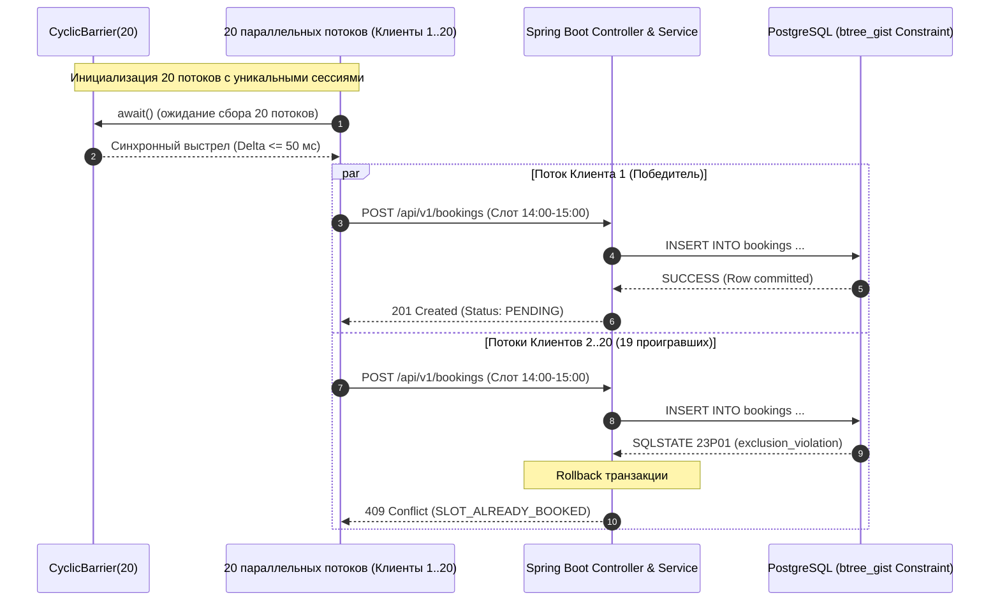

# Независимый тест-план: Сервис онлайн-записи на услуги (`service-booking`)

- **ID документа:** `TEST-PLAN-001`
- **Версия:** `1.0.0`
- **Дата составления:** `2026-11-03`
- **Профиль проекта:** `FULL_STACK` (Kotlin/JVM Backend + Web Frontend)
- **Роль:** `Independent QA Engineer`
- **Статус документа:** `APPROVED_FOR_EXECUTION`
- **Базовые спецификации и решения:**
  - Матрица критериев приёмки: [`docs/spec/handoff/05-acceptance-matrix.md`](file:///Users/sunmoonsuz/booking-service-realization/docs/spec/handoff/05-acceptance-matrix.md) (v1.0.0 APPROVED)
  - Спецификация требований: [`docs/spec/handoff/03-requirements.md`](file:///Users/sunmoonsuz/booking-service-realization/docs/spec/handoff/03-requirements.md) (v1.0.0 APPROVED)
  - Пользовательские сценарии: [`docs/spec/handoff/04-scenarios.md`](file:///Users/sunmoonsuz/booking-service-realization/docs/spec/handoff/04-scenarios.md) (v1.0.0 APPROVED)
  - Системная архитектура: [`docs/architecture/SYSTEM-ARCHITECTURE.md`](file:///Users/sunmoonsuz/booking-service-realization/docs/architecture/SYSTEM-ARCHITECTURE.md) (v1.0.0-PROPOSED)
  - Профиль инженерного проекта: [`docs/PROJECT-PROFILE.md`](file:///Users/sunmoonsuz/booking-service-realization/docs/PROJECT-PROFILE.md)
  - Архитектурные решения: [`docs/decisions/ADR-001-backend-framework-and-runtime.md`](file:///Users/sunmoonsuz/booking-service-realization/docs/decisions/ADR-001-backend-framework-and-runtime.md) — [`docs/decisions/ADR-012-catalog-master-lifecycle-and-mutation-rules.md`](file:///Users/sunmoonsuz/booking-service-realization/docs/decisions/ADR-012-catalog-master-lifecycle-and-mutation-rules.md)

---

## 1. Введение и область тестирования (Scope)

### 1.1. Назначение документа
Настоящий тест-план разработан независимым инженером по обеспечению качества (QA) для всесторонней, объективной и строгой верификации соответствия сервиса онлайн-записи на услуги утвержденным функциональным требованиям (`REQ-001` – `REQ-014`), критериям приёмки (`AC-001` – `AC-011`), граничным случаям (`AC-EDGE-001` – `AC-EDGE-009`), нефункциональным требованиям (`NFR-001` – `NFR-006`) и бизнес-правилам (`BR-001` – `BR-006`).

### 1.2. Объекты тестирования (In Scope)
1. **Серверный компонент (Backend):**
   - Kotlin 2.0 / Java 21 LTS / Spring Boot 3.3.x (Spring Web, Spring Security, Spring Data JPA / JDBC, Validation).
   - База данных PostgreSQL 16+ с расширением `btree_gist` и частичным exclusion constraint для защиты от овербукинга.
   - REST API v1 (`/api/v1/auth`, `/api/v1/services`, `/api/v1/masters`, `/api/v1/availability`, `/api/v1/bookings`, `/api/v1/client/*`, `/api/v1/admin/*`, `/api/v1/config`).
   - Аутентификация и сессии на базе HttpOnly Cookie (`JSESSIONID`, `SameSite=Lax`), хэширование паролей BCrypt (cost factor 12).
   - Ролевая модель доступа (RBAC): `GUEST`, `CLIENT`, `ADMIN`.
   - Движок расчета доступных слотов с поддержкой дискретной сетки (30/60 мин), обеденных перерывов, отсечения прошедших интервалов и конвертации в UTC (`Europe/Moscow`).
   - Конкурентная обработка параллельных заявок ($\ge 20$ одновременных запросов).
2. **Клиентский веб-компонент (Web Frontend):**
   - React 18/19, TypeScript, Vite, Tailwind CSS, TanStack Query v5, Lucide Icons, Axios.
   - Пользовательские экраны: каталог услуг и мастеров, интерактивный выбор даты и слота, модальные окна бронирования/авторизации, Личный кабинет клиента (активные записи, история, отмена).
   - Административный интерфейс: модерация входящих заявок (`PENDING` $\to$ `CONFIRMED`/`REJECTED`, `CONFIRMED` $\to$ `CANCELLED`/`COMPLETED`), управление каталогом услуг, мастерами и расписанием смен.
   - Перехват HTTP 409 Conflict и реактивное автообновление сетки слотов без полной перезагрузки страницы.
   - Адаптивная верстка под экраны от 360px (mobile) до 1440px+ (desktop).
3. **Межкомпонентные контракты и обработка ошибок:**
   - Соответствие контракту ошибок ADR-006 (HTTP 400, 401, 403, 404, 409, 500) со структурой `ApiErrorResponse` без утечки SQL-исключений и стектрейсов.

### 1.3. Исключено из области тестирования (Strictly Out of Scope)
- **Native Android и iOS мобильные приложения:** исключены полностью согласно `PROJECT-PROFILE.md`, `DEC-001`, `NFR-002`. Никакие тесты мобильных платформ не проектируются и не выполняются.
- **Онлайн-эквайринг, платежи, депозиты и фискализация:** исключены согласно `DEC-008`.
- **Внешние CRM, складские системы, SMS/мессенджер-шлюзы:** исключены согласно `DEC-008`.
- **Автоматический облачный CI/CD pipeline и распределенный multi-tenancy кластер:** сервис спроектирован как single-tenant локально развертываемое решение (`ASM-001`).

---

## 2. Стратегия тестирования и уровни проверок

В соответствии с профилем `FULL_STACK` определены применимые уровни верификации. Каждый уровень выбран исходя из архитектурных инвариантов и требований:

| Уровень тестирования | Что проверяется | Инструменты и среда | Обоснование выбора уровня |
|---|---|---|---|
| **Unit Tests (Backend)** | Валидация полуинтервалов $[T_{start}, T_{end})$, доменная машина статусов бронирования, правила отмены $T_{start} > T_{now}$, политика паролей $\ge 8$, маппинг сущностей в DTO, расчет снимков данных. | JUnit 5, MockK, AssertJ, Kotlin test library | Быстрая изоляция бизнес-правил ядра (`BR-001`–`BR-006`) без поднятия БД и веб-контекста. |
| **Integration Tests (Persistence / DB)** | Flyway миграции схемы БД, GiST exclusion constraint (`no_overlapping_active_bookings`), soft delete, каскадные правила, уникальность email без учета регистра. | Testcontainers (PostgreSQL 16 с `btree_gist`), Spring Data JPA, HikariCP | Подтверждение физической невозможности нарушения инвариантов на уровне СУБД (ADR-003, ADR-004). |
| **API & Security Tests (Component)** | Контроллеры REST API, Spring Security фильтры, RBAC ограничения (`GUEST`, `CLIENT`, `ADMIN`), генерация и инвалидация cookie сессий (`JSESSIONID`), структура ошибок `ApiErrorResponse`. | `@SpringBootTest`, `MockMvc` / `TestRestTemplate`, Testcontainers | Проверка соблюдения API-контрактов ADR-005, ADR-006 и защиты от несанкционированного доступа (`AC-008`). |
| **Concurrency & Overbooking Tests** | Гонка 20 одновременных потоков на один слот с дельтой $\le 50$ мс через `CyclicBarrier`. Проверка ровно 1 успешного (201 Created) и 19 отказов (409 Conflict). | JUnit 5, Virtual Threads / `ExecutorService`, `CyclicBarrier`, Testcontainers | Прямая верификация ключевого нефункционального требования `NFR-001` и критерия `AC-003`. |
| **Timezone & Schedule Engine Tests** | Генерация дискретной сетки слотов (30/60 мин), поддержка перерывов, отсечение прошедших слотов, конвертация дат между ISO-8601 UTC и `Europe/Moscow`. | JUnit 5, Spring Boot Test, `Clock.fixed()`, `ZoneId` | Верификация корректности расписания и соответствия `NFR-005`, `AC-002`, `AC-010`, `AC-EDGE-008`. |
| **Performance Benchmark Tests** | Нагрузочный бенчмарк генерации слотов: 50 виртуальных пользователей одновременно, 10 мастеров, 100 активных записей, горизонт 7 дней. Измерение p95 $\le 300$ мс. | k6 / Gatling / JUnit Multithreaded Benchmark Harness, HikariCP pool 30 | Подтверждение соответствия критерию `AC-011` и требованию `NFR-006`. |
| **Frontend Component & Unit Tests** | Рендеринг компонентов UI, валидация полей форм (email, пароль $\ge 8$, интервал графика $Start < End$), форматирование цен в RUB и дат в таймзоне заведения. | Vitest, React Testing Library, jsdom | Быстрая проверка клиентской логики и валидаций до браузерного тестирования. |
| **Frontend E2E & Browser Tests** | Сквозные пользовательские сценарии: бронирование слота, перехват 409 с автообновлением сетки слотов (`AC-004`), адаптивность от 360px (`NFR-003`), отмена в ЛК, админ-модерация. | Playwright / Chromium, WebKit, Firefox | Доказательство работоспособности интерфейса в реальных браузерах и мобильных вьюпортах. |

> [!NOTE]
> Уровень тестирования Android-приложений (Instrumented / Device / Compose) строго исключён и помечен как `N/A (OUT_OF_SCOPE)`, так как в утверждённом профиле `PROJECT-PROFILE.md` мобильный клиент отсутствует.

---

## 3. Матрица трассируемости (Traceability Matrix)

| Требование (REQ / NFR / BR) | Критерий приёмки (AC / AC-EDGE) | Сценарий (SCN) | ID тест-кейса | Название проверки | Уровень проверки |
|---|---|---|---|---|---|
| `REQ-001`, `REQ-002`, `NFR-004` | `AC-001` | `SCN-001` | `TC-E2E-001` | Регистрация нового клиента, хэширование пароля BCrypt, выдача сессии и вход в ЛК | E2E / Integration |
| `REQ-003`, `REQ-004`, `REQ-005` | `AC-002` | `SCN-002` | `TC-E2E-002` | Создание заявки на бронирование 60-мин слота со статусом `PENDING` и удержание слота | E2E / Integration |
| `REQ-006`, `REQ-007`, `NFR-001` | `AC-003` | `SCN-003` | `TC-CONC-001` | Конкурентная гонка 20 параллельных запросов на один слот: ровно 1 успешный (201), 19 отказов (409) | Concurrency / Automated |
| `REQ-007`, `NFR-003` | `AC-004` | `SCN-003` | `TC-UI-001` | Реакция Web UI на 409 Conflict: Toast-уведомление и автообновление сетки слотов без перезагрузки | UI / E2E |
| `REQ-008`, `REQ-009`, `BR-003` | `AC-005` | `SCN-004` | `TC-E2E-003` | Отмена активного бронирования клиентом через ЛК и моментальное высвобождение слота | E2E / Integration |
| `REQ-010`, `REQ-011`, `REQ-012` | `AC-006` | `SCN-005` | `TC-E2E-004` | Управление каталогом услуг, мастерами и графиком работы через панель администратора | E2E / Integration |
| `REQ-013`, `BR-002`, `BR-003` | `AC-007` | `SCN-005` | `TC-E2E-005` | Модерация администратором: Confirm (`CONFIRMED`), Reject (`REJECTED`), Cancel (`CANCELLED`) | E2E / Integration |
| `NFR-004` | `AC-008` | `SCN-001`, `SCN-005` | `TC-SEC-001` | Защита административных эндпоинтов: 401 для анонимов, 403 для роли `CLIENT` | Security / API |
| `REQ-014` | `AC-009` | `SCN-005` | `TC-E2E-006` | Завершение визита администратором (`COMPLETED`) и перенос записи в архив ЛК | E2E / Integration |
| `NFR-005` | `AC-010` | `SCN-002`, `SCN-003` | `TC-TIME-001` | Сохранение времени в БД в ISO-8601 UTC и отображение в локальном времени `Europe/Moscow` | Timezone / Integration |
| `NFR-006` | `AC-011` | `SCN-002` | `TC-PERF-001` | Нагрузочное тестирование расчета доступности: 50 параллельных пользователей, p95 $\le 300$ мс | Performance Benchmark |
| `BR-001` | `AC-EDGE-001` | `SCN-002` | `TC-EDGE-001` | Успешное создание смежных бронирований $[10:00, 11:00)$ и $[11:00, 12:00)$ без конфликта | Concurrency / DB |
| `BR-001` | `AC-EDGE-002` | `SCN-002` | `TC-EDGE-002` | Отклонение частично перекрывающихся интервалов $[10:00, 11:00)$ и $[10:30, 11:30)$ (409) | Concurrency / DB |
| `BR-005` | `AC-EDGE-003` | `SCN-001` | `TC-EDGE-003` | Попытка регистрации дубликата email в разном регистре (`Test@` vs `test@`) $\to$ 409 Conflict | API / Integration |
| `BR-005` | `AC-EDGE-004` | `SCN-001` | `TC-EDGE-004` | Валидация короткого пароля (< 8 символов) на фронтенде и бэкенде $\to$ 400 Bad Request | API / Validation |
| `BR-004` | `AC-EDGE-005` | `SCN-004` | `TC-EDGE-005` | Запрет отмены визита после наступления момента $T_{start}$ $\to$ 400 Bad Request | API / Business Rule |
| `REQ-004`, `REQ-012` | `AC-EDGE-006` | `SCN-002` | `TC-EDGE-006` | Попытка бронирования слота за пределами рабочих часов смены мастера $\to$ 400 Bad Request | API / Validation |
| `REQ-013`, `REQ-014` | `AC-EDGE-007` | `SCN-005` | `TC-EDGE-007` | Запрет недопустимых переходов состояний жизненного цикла $\to$ 400 Bad Request | API / State Machine |
| `BR-006` | `AC-EDGE-008` | `SCN-002` | `TC-EDGE-008` | Попытка бронирования слота в прошлом ($T_{start} \le T_{now}$) $\to$ 400 Bad Request | API / Time Validation |
| `REQ-012` | `AC-EDGE-009` | `SCN-005` | `TC-EDGE-009` | Валидация интервала расписания мастера: отклонение $End \le Start$ $\to$ 400 Bad Request | API / Validation |
| `REQ-008`, `REQ-009` | `ADR-005` | `SCN-004` | `TC-SEC-002` | Изоляция клиентских данных (IDOR): запрет просмотра/отмены чужих бронирований (403) | Security / API |
| `REQ-002` | `ADR-005` | `SCN-001` | `TC-SEC-003` | Завершение сеанса (Logout): инвалидация сессии на сервере и очистка cookie | Security / API |
| `ASM-007`, `NFR-004` | `ADR-009` | `SCN-005` | `TC-SEC-004` | Инициализация первичного администратора (Bootstrap Admin): хэш BCrypt, безопасность | Security / Integration |
| `REQ-003`, `REQ-010` | `ADR-011` | `SCN-004` | `TC-CAT-001` | Фиксация исторического снимка услуги (Snapshot Data): неизменность цены при правке каталога | DB / Integration |
| `REQ-011` | `ADR-012` | `SCN-005` | `TC-CAT-002` | Запрет деактивации мастера при наличии предстоящих активных записей $\to$ 400 Bad Request | API / Business Rule |
| `REQ-010` | `ADR-012` | `SCN-005` | `TC-CAT-003` | Запрет изменения длительности услуги при наличии будущих активных записей $\to$ 400 | API / Business Rule |
| `REQ-012` | `ADR-010` | `SCN-005` | `TC-SCHED-001` | Запрет сокращения графика мастера, конфликтующего с активными записями $\to$ 400 | API / Business Rule |
| `REQ-004`, `REQ-012` | `ADR-010` | `SCN-002` | `TC-SCHED-002` | Расчет слотов при наличии обеденного перерыва: слоты строго исключают интервал обеда | Algorithm / Unit |
| `REQ-004` | `ADR-010` | `SCN-002` | `TC-SCHED-003` | Расчет слотов: отсечение неполного остатка смены (хвост меньше длительности услуги) | Algorithm / Unit |
| Все REQ | `ADR-006` | Все SCN | `TC-ERR-001` | Унифицированный формат ошибок API (`error`, `message`, `details`) без утечки SQL-деталей | API / Contract |
| `NFR-003` | `NFR-003` | `SCN-001`..`005` | `TC-UI-002` | Адаптивность клиентского и административного интерфейса от 360px (mobile) до десктопа | UI / Responsive |
| `REQ-001`, `REQ-005` | `SCN-001` Alt 2 | `SCN-001` | `TC-UI-003` | Сохранение выбранного слота гостем при промежуточной авторизации/регистрации | UI / State Flow |

---

## 4. Детализированные тест-кейсы

### 4.1. Основные приёмочные сценарии (`AC-001` – `AC-011`)

#### `TC-E2E-001`: Регистрация нового клиента, хэширование пароля и выдача сессии
- **Связанные AC/REQ:** `AC-001`, `REQ-001`, `REQ-002`, `NFR-004`, `SCN-001`.
- **Предусловия:** Сервер запущен, база данных доступна. Пользователь открыл страницу `/register`.
- **Тестовые данные:**
  - Email: `client.e2e.01@example.com`
  - Пароль: `SuperSecret123!` ($\ge 8$ символов)
  - Имя: `Алексей Иванов`
  - Телефон: `+79991112233`
- **Шаги воспроизведения:**
  1. Заполнить форму регистрации указанными данными.
  2. Нажать кнопку «Зарегистрироваться».
  3. Проверить HTTP-ответ сервера на `POST /api/v1/auth/register`.
  4. Проверить полученные Set-Cookie заголовки.
  5. Выполнить прямой SQL-запрос к таблице `users`: `SELECT password_hash, role FROM users WHERE email = 'client.e2e.01@example.com'`.
  6. Отправить запрос `GET /api/v1/auth/me` с полученным cookie.
- **Ожидаемый результат:**
  - Сервер возвращает HTTP `201 Created` с JSON-телом профиля пользователя (`role: "CLIENT"`).
  - В ответе присутствует заголовок `Set-Cookie` с параметрами: `JSESSIONID`, `HttpOnly`, `SameSite=Lax`, `Path=/`.
  - В БД значение `password_hash` не содержит открытого пароля, начинается с префикса `$2a$` или `$2b$` (BCrypt) с длиной 60 символов. Поле `role` строго равно `CLIENT`.
  - Запрос `GET /api/v1/auth/me` возвращает `200 OK` с данными созданного клиента.
  - В браузере происходит переход в Личный кабинет.
- **Приоритет:** Blocker.

---

#### `TC-E2E-002`: Оформление заявки на 60-минутный слот со статусом `PENDING`
- **Связанные AC/REQ:** `AC-002`, `REQ-003`, `REQ-004`, `REQ-005`, `BR-001`, `BR-002`, `SCN-002`.
- **Предусловия:** Клиент авторизован. В каталоге существует активный мастер $M$, оказывающий активную услугу $S$ длительностью 60 мин (цена 1 500.00 ₽). На завтрашний день у мастера настроена смена 10:00–18:00 (MSK), бронирований нет.
- **Тестовые данные:**
  - Дата: Завтрашний день ($D+1$)
  - Слот: `10:00 – 11:00` по локальному времени заведения (`Europe/Moscow`).
- **Шаги воспроизведения:**
  1. Выполнить `GET /api/v1/availability?masterId={masterId}&serviceId={serviceId}&date={targetDate}`.
  2. Убедиться, что слот присутствует в списке доступных.
  3. Отправить `POST /api/v1/bookings` с телом:
     ```json
     {
       "masterId": "{masterId}",
       "serviceId": "{serviceId}",
       "startTime": "{targetDate}T07:00:00Z"
     }
     ```
  4. Проверить HTTP-код и тело ответа.
  5. Повторно выполнить `GET /api/v1/availability` на ту же дату.
  6. Проверить запись в БД `SELECT status, service_name_snapshot, service_price_snapshot FROM bookings WHERE id = :bookingId`.
- **Ожидаемый результат:**
  - Сервер возвращает HTTP `201 Created` с объектом бронирования: статус `PENDING`, `serviceName` и `price` соответствуют услуге.
  - В БД запись имеет статус `PENDING`, зафиксированы снимки цены и названия.
  - При повторном запросе доступности интервал `10:00 – 11:00` отсутствует в списке свободных слотов (слот заблокирован).
  - В интерфейсе отображается экран «Заявка принята, ожидает подтверждения».
- **Приоритет:** Blocker.

---

#### `TC-CONC-001`: Конкурентная гонка 20 клиентов на один слот (Защита от овербукинга)
- **Связанные AC/REQ:** `AC-003`, `REQ-006`, `REQ-007`, `NFR-001`, `ADR-004`, `SCN-003`.
- **Предусловия:** Подготовлен мастер $M$ со сменой на дату $D$, свободен слот $[14:00, 15:00)$ MSK (`11:00:00Z`). В БД созданы 20 уникальных клиентов (`client_01` .. `client_20`), для каждого получена авторизационная сессия. Пул соединений HikariCP сконфигурирован на `maximum-pool-size = 30`.
- **Тестовые данные:** 20 одновременных запросов с одинаковым телом: `masterId: M`, `serviceId: S`, `startTime: D + "T11:00:00Z"`.
- **Шаги воспроизведения:**
  1. Инициализировать `CyclicBarrier(20)` в тесте.
  2. Запустить 20 параллельных потоков через `Executors.newVirtualThreadPerTaskExecutor()` (или пул потоков).
  3. В каждом потоке: дойти до барьера `barrier.await()`, затем синхронно отправить HTTP `POST /api/v1/bookings` от имени своего клиента.
  4. Зафиксировать коды и тела всех 20 HTTP-ответов.
  5. Выполнить верификационный SQL-запрос:
     ```sql
     SELECT id, client_id, status FROM bookings 
     WHERE master_id = :masterId 
       AND start_time = :startTime 
       AND status IN ('PENDING', 'CONFIRMED');
     ```
- **Ожидаемый результат:**
  - Ровно 1 HTTP-запрос возвращает статус `201 Created` с телом бронирования в статусе `PENDING`.
  - Ровно 19 HTTP-запросов возвращают статус `409 Conflict` со стандартизированным телом:
    ```json
    {
      "error": "SLOT_ALREADY_BOOKED",
      "message": "Выбранный слот уже занят другим клиентом. Пожалуйста, выберите другое время."
    }
    ```
  - В таблице `bookings` создана **ровно 1 запись**.
  - Отсутствуют ошибки 500, отсутствует падение пула соединений БД (ConnectionTimeout).
- **Приоритет:** Blocker.

---

#### `TC-UI-001`: Перехват 409 Conflict фронтендом и реактивное автообновление слотов
- **Связанные AC/REQ:** `AC-004`, `REQ-007`, `NFR-003`, `SCN-003`.
- **Предусловия:** В браузере открыта страница бронирования услуги $S$ к мастеру $M$. В сетке слотов отображается слот $[14:00, 15:00)$.
- **Тестовые данные:** Клиент $A$ (внешний) и Клиент $B$ (в браузере).
- **Шаги воспроизведения:**
  1. До клика Клиента $B$ отправить через API фоновое бронирование слота $[14:00, 15:00)$ от Клиента $A$ (слот становится занят в БД).
  2. Клиент $B$ в браузере кликает на слот $[14:00, 15:00)$ и нажимает кнопку «Отправить заявку».
  3. Отследить перехват сетевого ответа 409 в TanStack Query / Axios.
  4. Проверить появление всплывающего Toast-уведомления.
  5. Проверить состояние кнопки занятого слота без ручной перезагрузки страницы (F5).
- **Ожидаемый результат:**
  - В UI появляется уведомление: «К сожалению, этот слот только что заняли. Пожалуйста, выберите другое время».
  - Без перезагрузки всей страницы срабатывает фоновый перезапрос слотов (`queryClient.invalidateQueries`).
  - Слот $[14:00, 15:00)$ меняет визуальное состояние: становится неактивным/серым (disabled) с подсказкой «Занято» или удаляется из доступных.
  - Пользователь может выбрать другой доступный слот без потери контекста услуги и мастера.
- **Приоритет:** Critical.

---

#### `TC-E2E-003`: Отмена активного бронирования клиентом через Личный кабинет
- **Связанные AC/REQ:** `AC-005`, `REQ-008`, `REQ-009`, `BR-003`, `BR-004`, `SCN-004`.
- **Предусловия:** Клиент авторизован, имеет активную будущую запись на завтра $[16:00, 17:00)$ в статусе `PENDING` или `CONFIRMED`.
- **Шаги воспроизведения:**
  1. Клиент переходит в раздел «Личный кабинет» (`/cabinet`).
  2. Находит карточку записи на $[16:00, 17:00)$ в блоке «Текущие записи».
  3. Нажимает кнопку «Отменить».
  4. В модальном диалоге подтверждения «Вы уверены?» нажимает «Да, отменить».
  5. Проверить HTTP-ответ `POST /api/v1/client/bookings/{id}/cancel`.
  6. Проверить статус записи в ЛК и в БД.
  7. Запросить `GET /api/v1/availability` на дату отмененного слота.
- **Ожидаемый результат:**
  - Сервер возвращает `200 OK`, статус записи обновляется на `CANCELLED`.
  - В ЛК карточка перемещается в блок «История» со статусом «Отменена», кнопка отмены скрыта.
  - Слот $[16:00, 17:00)$ **немедленно появляется в выдаче доступных слотов** для любого клиента.
- **Приоритет:** Critical.

---

#### `TC-E2E-004`: Управление услугами, мастерами и расписанием в панели администратора
- **Связанные AC/REQ:** `AC-006`, `REQ-010`, `REQ-011`, `REQ-012`, `SCN-005`.
- **Предусловия:** Авторизован администратор (`ROLE_ADMIN`).
- **Тестовые данные:**
  - Услуга: «Комплексный уход», 60 мин, 2 500.00 ₽.
  - Мастер: «Елена Смирнова», описание: «Топ-стилист».
  - Расписание: Понедельник (`dayOfWeek = 1`), с 10:00 до 18:00.
- **Шаги воспроизведения:**
  1. Администратор переходит в `/admin/services`, нажимает «Добавить услугу», заполняет поля и сохраняет.
  2. Переходит в `/admin/masters`, нажимает «Добавить мастера», указывает ФИО и привязывает созданную услугу.
  3. Переходит во вкладку «Расписание», выбирает мастера и настраивает понедельник с 10:00 до 18:00.
  4. Выйти из админки, зайти как клиент/гость в публичный каталог.
  5. Выбрать добавленную услугу, мастера и ближайший понедельник.
- **Ожидаемый результат:**
  - Услуга и мастер успешно сохранены в БД с флагами `is_active = true`.
  - В таблице `master_schedules` создана запись с интервалом `10:00:00` – `18:00:00`.
  - В клиентском каталоге отображается новая услуга и мастер.
  - На выбранный понедельник клиент видит полную сетку слотов: 10:00, 11:00, 12:00, 13:00, 14:00, 15:00, 16:00, 17:00.
- **Приоритет:** Critical.

---

#### `TC-E2E-005`: Модерация заявок администратором (Подтвердить, Отклонить, Отменить визит)
- **Связанные AC/REQ:** `AC-007`, `REQ-013`, `BR-002`, `BR-003`, `SCN-005`.
- **Предусловия:** В системе созданы 3 заявки от клиентов на разные слоты:
  - Заявка 1: `PENDING` на слот 10:00–11:00.
  - Заявка 2: `PENDING` на слот 12:00–13:00.
  - Заявка 3: `CONFIRMED` на слот 14:00–15:00.
- **Шаги воспроизведения:**
  1. Администратор открывает `/admin/bookings`.
  2. Для Заявки 1 нажимает «Подтвердить» (`POST /api/v1/admin/bookings/{id}/confirm`).
  3. Для Заявки 2 нажимает «Отклонить» (`POST /api/v1/admin/bookings/{id}/reject`).
  4. Для Заявки 3 нажимает «Отменить запись» (`POST /api/v1/admin/bookings/{id}/cancel`).
  5. Проверить статусы в БД и доступность слотов через `GET /api/v1/availability`.
- **Ожидаемый результат:**
  - Заявка 1 переходит в статус `CONFIRMED`. Слот 10:00–11:00 **остается заблокированным**.
  - Заявка 2 переходит в статус `REJECTED`. Слот 12:00–13:00 **немедленно высвобождается** и становится доступным.
  - Заявка 3 переходит в статус `CANCELLED`. Слот 14:00–15:00 **немедленно высвобождается** и становится доступным.
  - Все клиенты в своих ЛК видят корректно обновленные статусы.
- **Приоритет:** Blocker.

---

#### `TC-SEC-001`: Ролевой доступ и защита эндпоинтов администрирования (RBAC)
- **Связанные AC/REQ:** `AC-008`, `NFR-004`, `ADR-005`, `SCN-005`.
- **Предусловия:** Сервис запущен. В системе существуют: неаутентифицированный клиент (гость), клиент с ролью `CLIENT` и администратор с ролью `ADMIN`.
- **Шаги воспроизведения:**
  1. Отправить `GET /api/v1/admin/bookings` без передачи сессионной cookie.
  2. Отправить `GET /api/v1/admin/bookings` с cookie пользователя роли `CLIENT`.
  3. Отправить `POST /api/v1/admin/services` с телом создания услуги от имени роли `CLIENT`.
  4. Отправить `GET /api/v1/admin/bookings` с cookie пользователя роли `ADMIN`.
- **Ожидаемый результат:**
  - Запрос 1 возвращает HTTP `401 Unauthorized` с телом `{"error": "UNAUTHORIZED", ...}` (без HTML редиректа 302).
  - Запрос 2 возвращает HTTP `403 Forbidden` с телом `{"error": "ACCESS_DENIED", ...}`.
  - Запрос 3 возвращает HTTP `403 Forbidden`. Никаких изменений в каталог не вносится.
  - Запрос 4 возвращает HTTP `200 OK` со списком заявок.
- **Приоритет:** Blocker.

---

#### `TC-E2E-006`: Завершение визита администратором (`COMPLETED`)
- **Связанные AC/REQ:** `AC-009`, `REQ-014`, `SCN-005`.
- **Предусловия:** Имеется подтвержденная запись (`CONFIRMED`), время которой наступило или прошло.
- **Шаги воспроизведения:**
  1. Администратор открывает `/admin/bookings`.
  2. Нажимает кнопку «Завершить визит» (`POST /api/v1/admin/bookings/{id}/complete`).
  3. Проверить HTTP-ответ и статус записи в таблице `bookings`.
  4. Зайти в ЛК клиента и проверить отображение визита.
- **Ожидаемый результат:**
  - Сервер возвращает `200 OK`. Статус записи в БД меняется на `COMPLETED`.
  - В ЛК клиента запись отображается в блоке «История» со статусом «Завершена».
  - Слот остается в архиве, повторно не открывается (так как время в прошлом).
- **Приоритет:** Major.

---

#### `TC-TIME-001`: Хранение в ISO-8601 UTC и отображение в локальном времени заведения
- **Связанные AC/REQ:** `AC-010`, `NFR-005`, `ADR-007`, `SCN-002`.
- **Предусловия:** Стенд сконфигурирован с переменной `APP_TIMEZONE = Europe/Moscow` (UTC+3).
- **Тестовые данные:** Дата визита: `2026-11-10`, выбранное локальное время: `14:00 – 15:00` (MSK).
- **Шаги воспроизведения:**
  1. Клиент оформляет бронирование на `14:00` локального времени.
  2. Зафиксировать отправляемое в `POST /api/v1/bookings` значение `startTime`.
  3. Выполнить SQL-запрос: `SELECT start_time, end_time FROM bookings WHERE id = :id`.
  4. Вызвать `GET /api/v1/client/bookings` и проверить JSON-ответ.
  5. Проверить рендеринг времени в карточке бронирования в браузере.
- **Ожидаемый результат:**
  - В `POST /api/v1/bookings` передается точная UTC-метка: `2026-11-10T11:00:00Z`.
  - В БД в колонках `TIMESTAMPTZ` значение физически сохранено как `2026-11-10 11:00:00+00` (UTC).
  - В ответе `GET /api/v1/client/bookings` поле `startTime` имеет значение `2026-11-10T11:00:00Z`.
  - В интерфейсе клиента и администратора отображается точное локальное время: **`14:00`** (независимо от локальной таймзоны операционной системы клиента, благодаря форматированию с явным указанием зоны заведения).
- **Приоритет:** Blocker.

---

#### `TC-PERF-001`: Нагрузочное тестирование расчета доступности слотов (p95 $\le 300$ мс)
- **Связанные AC/REQ:** `AC-011`, `NFR-006`, `SCN-002`.
- **Предусловия:** В базе данных предварительно сгенерированы: 10 активных мастеров со сложными недельными графиками (каждый день по 2 интервала с обедом), 10 активных услуг, 100 активных бронирований (`PENDING`, `CONFIRMED`), распределенных по ближайшим 7 дням. Пул HikariCP: 30 соединений.
- **Тестовые данные:** 50 одновременных виртуальных пользователей (VU), выполняющих запросы `GET /api/v1/availability?masterId={id}&serviceId={id}&date={date}` в течение 60 секунд.
- **Шаги воспроизведения:**
  1. Запустить нагрузочный сценарий (k6 / Gatling / JUnit concurrency runner).
  2. Сгенерировать нагрузку с выходом на плато 50 параллельных потоков.
  3. Собрать метрики задержки (latency): avg, min, p50, p90, p95, p99, max, количество 5xx ошибок.
- **Ожидаемый результат:**
  - Время ответа 95-го перцентиля (p95) $\le 300$ мс.
  - 99-й перцентиль (p99) $\le 500$ мс.
  - Количество ошибок HTTP 5xx равно **0%**.
  - Сервер сохраняет стабильность, отсутствуют утечки соединений в пуле.
- **Приоритет:** Critical.

---

### 4.2. Граничные и негативные сценарии (`AC-EDGE-001` – `AC-EDGE-009`)

#### `TC-EDGE-001`: Смежные временные интервалы к одному мастеру
- **Связанные AC/REQ:** `AC-EDGE-001`, `BR-001`, `SCN-002`, `ADR-004`.
- **Предусловия:** Мастер $M$ свободен с 10:00 до 12:00.
- **Тестовые данные:** Запись 1: $[10:00, 11:00)$ UTC; Запись 2: $[11:00, 12:00)$ UTC.
- **Шаги воспроизведения:**
  1. Клиент 1 создает бронирование на слот $[10:00, 11:00)$.
  2. Клиент 2 сразу после этого создает бронирование на слот $[11:00, 12:00)$ к тому же мастеру.
- **Ожидаемый результат:**
  - Оба запроса возвращают HTTP `201 Created`.
  - В БД успешно сохраняются обе записи. Ограничение GiST exclusion constraint не срабатывает, так как полуинтервалы $[10:00, 11:00)$ и $[11:00, 12:00)$ не пересекаются в точке $11:00$.
- **Приоритет:** Blocker.

---

#### `TC-EDGE-002`: Частично перекрывающиеся временные интервалы
- **Связанные AC/REQ:** `AC-EDGE-002`, `BR-001`, `SCN-002`, `ADR-004`.
- **Предусловия:** Мастер $M$ имеет активную запись на $[10:00, 11:00)$ в статусе `PENDING`.
- **Тестовые данные:** Попытка создания записи на $[10:30, 11:30)$ к мастеру $M$.
- **Шаги воспроизведения:**
  1. Отправить `POST /api/v1/bookings` на слот $[10:30, 11:30)$.
  2. Проверить перехват ошибки на сервере.
- **Ожидаемый результат:**
  - Сервер возвращает HTTP `409 Conflict` (`SLOT_ALREADY_BOOKED`).
  - Вторая запись не создается.
- **Приоритет:** Blocker.

---

#### `TC-EDGE-003`: Регистрация с существующим email без учета регистра символов
- **Связанные AC/REQ:** `AC-EDGE-003`, `BR-005`, `ADR-006`, `SCN-001`.
- **Предусловия:** В системе зарегистрирован пользователь с email `ivan.petrov@example.com`.
- **Тестовые данные:** Попытка регистрации с email `Ivan.Petrov@Example.com` или `IVAN.PETROV@EXAMPLE.COM`.
- **Шаги воспроизведения:**
  1. Отправить `POST /api/v1/auth/register` с email `Ivan.Petrov@Example.com`.
- **Ожидаемый результат:**
  - Сервер возвращает HTTP `409 Conflict` (согласно ADR-006) с телом:
    ```json
    {
      "error": "EMAIL_ALREADY_EXISTS",
      "message": "Пользователь с таким email уже зарегистрирован",
      "timestamp": "..."
    }
    ```
  - Дублирующая запись в таблицу `users` не добавляется (срабатывает индекс `idx_users_email_ci`).
- **Приоритет:** Critical.

---

#### `TC-EDGE-004`: Валидация короткого пароля (< 8 символов)
- **Связанные AC/REQ:** `AC-EDGE-004`, `BR-005`, `ADR-006`, `SCN-001`.
- **Тестовые данные:** Пароль из 7 символов: `Pass12!`.
- **Шаги воспроизведения:**
  1. Ввести пароль `Pass12!` на форме регистрации в Web UI.
  2. Проверить реакцию клиентской валидации.
  3. Отправить прямой запрос `POST /api/v1/auth/register` с коротким паролем в обход UI.
- **Ожидаемый результат:**
  - В UI кнопка отправки заблокирована, поле подсвечено ошибкой «Пароль должен содержать не менее 8 символов».
  - Бэкенд возвращает HTTP `400 Bad Request` с кодом `VALIDATION_FAILED` и описанием поля `password` в массиве `details`. Пользователь не создается.
- **Приоритет:** Critical.

---

#### `TC-EDGE-005`: Запрет отмены визита после наступления времени начала
- **Связанные AC/REQ:** `AC-EDGE-005`, `BR-004`, `ADR-006`, `SCN-004`.
- **Предусловия:** Имеется запись клиента со статусом `CONFIRMED`. В тестовом окружении текущее время `Clock` установлено позже $T_{start}$ (например, визит начался в 10:00, текущее время 10:05).
- **Шаги воспроизведения:**
  1. Клиент пытается отправить `POST /api/v1/client/bookings/{id}/cancel`.
- **Ожидаемый результат:**
  - Сервер возвращает HTTP `400 Bad Request` с телом:
    ```json
    {
      "error": "CANCELLATION_DEADLINE_EXCEEDED",
      "message": "Нельзя отменить услугу, время которой уже наступило",
      "timestamp": "..."
    }
    ```
  - Статус записи в БД остается `CONFIRMED`.
- **Приоритет:** Critical.

---

#### `TC-EDGE-006`: Попытка бронирования слота за пределами рабочих часов мастера
- **Связанные AC/REQ:** `AC-EDGE-006`, `ADR-006`, `ADR-010`, `SCN-002`.
- **Предусловия:** Рабочий график мастера на день: 10:00–18:00 (MSK).
- **Тестовые данные:** Запрос на слот $[18:00, 19:00)$ MSK или $[09:00, 10:00)$ MSK.
- **Шаги воспроизведения:**
  1. Клиент отправляет прямой HTTP `POST /api/v1/bookings` на время `18:00`.
- **Ожидаемый результат:**
  - Сервер возвращает HTTP `400 Bad Request` с кодом ошибки `OUTSIDE_WORKING_HOURS` и понятным сообщением. Запись не создается.
- **Приоритет:** Major.

---

#### `TC-EDGE-007`: Запрет недопустимых переходов состояний бронирования
- **Связанные AC/REQ:** `AC-EDGE-007`, `ADR-006`, `SCN-005`.
- **Предусловия:** В БД имеются записи в различных статусах:
  - Запись А: `REJECTED`
  - Запись Б: `CANCELLED`
  - Запись В: `COMPLETED`
- **Шаги воспроизведения:**
  1. Попытка подтвердить отклоненную запись: `POST /api/v1/admin/bookings/{idA}/confirm`.
  2. Попытка отменить завершенную запись: `POST /api/v1/admin/bookings/{idB}/cancel`.
  3. Попытка завершить отмененную запись: `POST /api/v1/admin/bookings/{idC}/complete`.
- **Ожидаемый результат:**
  - Во всех трех случаях сервер возвращает HTTP `400 Bad Request` с кодом `INVALID_STATUS_TRANSITION`.
  - Статусы записей в БД остаются неизменными.
- **Приоритет:** Critical.

---

#### `TC-EDGE-008`: Запрет бронирования слота в прошлом
- **Связанные AC/REQ:** `AC-EDGE-008`, `BR-006`, `ADR-006`, `SCN-002`.
- **Предусловия:** Текущее системное время зафиксировано как `2026-11-03 12:00:00 MSK`.
- **Тестовые данные:** Попытка забронировать слот на `2026-11-03 10:00:00 MSK` ($T_{start} \le T_{now}$).
- **Шаги воспроизведения:**
  1. Клиент отправляет `POST /api/v1/bookings` со временем начала в прошлом.
- **Ожидаемый результат:**
  - Сервер возвращает HTTP `400 Bad Request` с кодом ошибки `BOOKING_IN_PAST`:
    ```json
    {
      "error": "BOOKING_IN_PAST",
      "message": "Нельзя забронировать время в прошлом",
      "timestamp": "..."
    }
    ```
  - Заявка не создается.
- **Приоритет:** Critical.

---

#### `TC-EDGE-009`: Валидация некорректного интервала расписания мастера ($End \le Start$)
- **Связанные AC/REQ:** `AC-EDGE-009`, `REQ-012`, `ADR-006`, `ADR-010`, `SCN-005`.
- **Предусловия:** Администратор находится на странице настройки графика мастера.
- **Тестовые данные:**
  - Тест 1: `startTime: "18:00"`, `endTime: "10:00"` ($End < Start$).
  - Тест 2: `startTime: "12:00"`, `endTime: "12:00"` ($End == Start$).
- **Шаги воспроизведения:**
  1. Попытаться сохранить график с указанными интервалами через Web UI.
  2. Отправить прямой запрос `PUT /api/v1/admin/masters/{id}/schedule` с некорректным интервалом.
- **Ожидаемый результат:**
  - В UI форма блокирует сохранение с подсказкой «Время окончания смены должно быть позже времени начала».
  - API бэкенда возвращает HTTP `400 Bad Request` с кодом `INVALID_SCHEDULE_INTERVAL`.
  - В БД срабатывает ограничение целостности `CONSTRAINT chk_schedule_interval CHECK (start_time < end_time)`.
- **Приоритет:** Critical.

---

### 4.3. Безопасность, RBAC, аудит и ADR-специфичные проверки

#### `TC-SEC-002`: Изоляция данных клиента (IDOR-защита)
- **Связанные AC/REQ:** `ADR-005`, `REQ-008`, `REQ-009`.
- **Предусловия:** В системе есть Запись 1, принадлежащая Клиенту 1. Авторизован Клиент 2.
- **Шаги воспроизведения:**
  1. Клиент 2 отправляет запрос `POST /api/v1/client/bookings/{idЗаписи1}/cancel`.
  2. Клиент 2 запрашивает детали чужого визита.
- **Ожидаемый результат:**
  - Сервер возвращает HTTP `403 Forbidden` (`ACCESS_DENIED`).
  - Клиент 2 не может отменить чужую запись и не получает приватных данных Клиента 1.
- **Приоритет:** Blocker.

---

#### `TC-SEC-003`: Завершение сеанса (Logout) с серверной инвалидацией
- **Связанные AC/REQ:** `REQ-002`, `ADR-005`, `SCN-001`.
- **Предусловия:** Пользователь авторизован, cookie `JSESSIONID` сохранена.
- **Шаги воспроизведения:**
  1. Пользователь вызывает `POST /api/v1/auth/logout`.
  2. Проверить HTTP-ответ и заголовок очистки cookie.
  3. Отправить повторный защищенный запрос `GET /api/v1/client/bookings` со старой cookie.
- **Ожидаемый результат:**
  - Ответ на logout `200 OK`, cookie сбрасывается (`Max-Age=0`).
  - Сервер инвалидирует сессию в `SecurityContextRepository`.
  - Повторный запрос со старой cookie завершается HTTP `401 Unauthorized`.
- **Приоритет:** Critical.

---

#### `TC-SEC-004`: Инициализация учетной записи администратора (Bootstrap Admin)
- **Связанные AC/REQ:** `ASM-007`, `NFR-004`, `ADR-009`, `SCN-005`.
- **Предусловия:** Чистая база данных после прогона миграций Flyway, отсутствие записей в таблице `users`. Переменные окружения: `APP_BOOTSTRAP_ADMIN_EMAIL=admin@example.com`, `APP_BOOTSTRAP_ADMIN_PASSWORD=admin12345`.
- **Шаги воспроизведения:**
  1. Запустить Spring Boot приложение (`AdminBootstrapRunner`).
  2. Проверить логи приложения на предмет утечки открытого пароля.
  3. Проверить запись в таблице `users`: `SELECT email, password_hash, role, name, phone FROM users`.
  4. Перезапустить приложение второй раз.
- **Ожидаемый результат:**
  - В таблице `users` создана запись: `role = 'ADMIN'`, `name = "Administrator"`, `phone = "+70000000000"`.
  - Пароль захэширован через BCrypt.
  - В логах зафиксировано только сообщение `Bootstrap admin user created with email: admin@example.com`. Пароль в логах **отсутствует**.
  - При повторном запуске инициализация пропускается (`Admin user already exists`), существующий пароль не сбрасывается.
- **Приоритет:** Critical.

---

#### `TC-CAT-001`: Фиксация исторического снимка услуги в бронировании (Snapshot Data)
- **Связанные AC/REQ:** `ADR-011`, `REQ-003`, `REQ-008`, `REQ-010`, `SCN-004`.
- **Предусловия:** Существует услуга «Массаж» со стоимостью 2 000.00 ₽. Клиент создал бронирование по этой услуге.
- **Шаги воспроизведения:**
  1. Администратор заходит в панель управления и меняет цену услуги в каталоге с 2 000.00 ₽ на 3 500.00 ₽, а название на «Массаж Премиум».
  2. Клиент открывает свой Личный кабинет (`/cabinet`).
  3. Администратор открывает просмотр исторических заявок.
- **Ожидаемый результат:**
  - В карточке ранее оформленного бронирования клиента отображаются первоначальные данные: цена **2 000.00 ₽** и название **«Массаж»** (прочитаны из колонок `service_price_snapshot` и `service_name_snapshot`).
  - Новая цена 3 500.00 ₽ применяется исключительно к вновь создаваемым бронированиям.
- **Приоритет:** Critical.

---

#### `TC-CAT-002`: Запрет деактивации мастера при наличии предстоящих активных записей
- **Связанные AC/REQ:** `ADR-012`, `REQ-011`, `SCN-005` E3.
- **Предусловия:** У мастера $M$ есть подтвержденная запись на следующую неделю.
- **Шаги воспроизведения:**
  1. Администратор отправляет `DELETE /api/v1/admin/masters/{id}` (мягкое удаление / деактивация).
- **Ожидаемый результат:**
  - Сервер отклоняет операцию HTTP `400 Bad Request` с кодом `MASTER_HAS_ACTIVE_BOOKINGS`.
  - В интерфейсе выводится сообщение: «У мастера есть активные записи. Сначала перенесите или отмените их».
  - Флаг `is_active` мастера остается `true`.
- **Приоритет:** Major.

---

#### `TC-CAT-003`: Запрет модификации длительности услуги при наличии активных бронирований
- **Связанные AC/REQ:** `ADR-012`, `REQ-010`.
- **Предусловия:** Услуга длительностью 30 мин имеет активные будущие бронирования.
- **Шаги воспроизведения:**
  1. Администратор пытается изменить длительность услуги с 30 мин на 60 мин (`PUT /api/v1/admin/services/{id}`).
- **Ожидаемый результат:**
  - Сервер отклоняет запрос HTTP `400 Bad Request` с кодом `CANNOT_MODIFY_DURATION_WITH_ACTIVE_BOOKINGS`.
  - Длительность услуги не изменяется.
- **Приоритет:** Major.

---

#### `TC-SCHED-001`: Валидация сокращения расписания мастера при активных записях
- **Связанные AC/REQ:** `ADR-010`, `REQ-012`.
- **Предусловия:** У мастера назначена смена 10:00–18:00 и есть подтвержденная запись на 17:00–18:00.
- **Шаги воспроизведения:**
  1. Администратор пытается сократить рабочий график мастера на этот день до 10:00–16:00.
- **Ожидаемый результат:**
  - Сервер отклоняет запрос HTTP `400 Bad Request` с кодом `SCHEDULE_CONFLICTS_WITH_ACTIVE_BOOKINGS`.
  - График мастера остается прежним.
- **Приоритет:** Major.

---

#### `TC-ERR-001`: Проверка стандартизированного формата ошибок API (ADR-006)
- **Связанные AC/REQ:** `ADR-006`, все AC.
- **Шаги воспроизведения:**
  1. Вызвать ошибки 400 (невалидное DTO), 401 (нет токена), 403 (клиент в админку), 404 (несуществующий ID), 409 (овербукинг).
  2. Проверить JSON-структуру каждого ответа.
- **Ожидаемый результат:**
  - Каждый ошибочный ответ строго содержит поля:
    - `"error"`: строковый код ошибки (например, `VALIDATION_FAILED`, `UNAUTHORIZED`, `SLOT_ALREADY_BOOKED`);
    - `"message"`: понятное пользователю сообщение на русском языке;
    - `"timestamp"`: временная метка ISO-8601 UTC.
  - При ошибках валидации (400) присутствует массив `"details"` с указанием полей и причин.
  - В теле ответа **строго отсутствуют**: SQL-текст, имена таблиц, стек-трейсы Java/Kotlin, имена Java-классов исключений.
- **Приоритет:** Critical.

---

## 5. Программа тестирования многопоточного овербукинга (`AC-003` / `NFR-001`)

### 5.1. Цель и контекст испытания
Подтвердить 100% математическую надежность инварианта предотвращения двойного бронирования (`GOAL-002`, `NFR-001`, `AC-003`, `ADR-004`) в условиях реальной конкурентной гонки на уровне СУБД PostgreSQL.

### 5.2. Архитектура и конфигурация тестового стенда
- **СУБД:** PostgreSQL 16 в Testcontainers с подключенным расширением `btree_gist`.
- **Пул соединений:** HikariCP с настройками `maximum-pool-size = 30`, `connection-timeout = 20000` (чтобы исключить ложные отказы по нехватке соединений пула).
- **Синхронизатор потоков:** `java.util.concurrent.CyclicBarrier(20)` для гарантии одновременного спуска запросов с дельтой $\le 50$ мс.
- **Runtime потоков:** виртуальные потоки Java 21 (`Executors.newVirtualThreadPerTaskExecutor()`).

### 5.3. Схема выполнения теста



### 5.4. Алгоритм и критерии верификации
1. **Генерация фикстур:** мастер $M$, услуга $S$ длительностью 60 мин, 20 предсозданных пользователей с сохраненными в БД хэшами и полученными сессионными cookie `JSESSIONID`.
2. **Запуск:** 20 потоков стартуют и блокируются на `barrier.await()`. После разблокировки каждый поток отправляет HTTP-запрос на один и тот же целевой интервал.
3. **Фиксация результатов:** сбор статусов в `ConcurrentLinkedQueue<Integer>` и объектов ответов.
4. **Meaningful Assertions:**
   - `count(status == 201) == 1` (строго 1 успешное бронирование).
   - `count(status == 409) == 19` (строго 19 отказов с телом `SLOT_ALREADY_BOOKED`).
   - `count(status == 500) == 0` (ноль внутренних сбоев сервера).
   - Прямой SQL-запрос к БД: `SELECT count(*) FROM bookings WHERE master_id = ? AND start_time = ? AND status IN ('PENDING', 'CONFIRMED')` возвращает **строго 1**.
5. **Тест на флаковость (Flakiness Guard):** Прогон теста выполняется **5 раз подряд**. При наличии хотя бы одного отклонения тест считается проваленным.

---

## 6. Программа проверки расчета слотов и таймзон (`AC-002`, `AC-010`, `AC-EDGE-008`, `ADR-007`, `ADR-010`)

### 6.1. Тестирование дискретной сетки слотов (30 и 60 минут)
- **Цель:** убедиться, что шаг сетки строго равен длительности запрошенной услуги (`DEC-006`, `ADR-010`).
- **Сценарий 1 (Услуга 30 мин):**
  - Смена мастера: 10:00 – 12:00.
  - Ожидаемый список слотов: 10:00–10:30, 10:30–11:00, 11:00–11:30, 11:30–12:00 (ровно 4 слота).
- **Сценарий 2 (Услуга 60 мин):**
  - Смена мастера: 10:00 – 12:00.
  - Ожидаемый список слотов: 10:00–11:00, 11:00–12:00 (ровно 2 слота).
- **Сценарий 3 (Неполный остаток смены — краевой случай):**
  - Смена мастера: 10:00 – 12:30. Услуга длительностью 60 мин.
  - Ожидаемые слоты: 10:00–11:00, 11:00–12:00. Хвост 12:00–12:30 (30 мин) **не должен генерироваться**, так как $Slot_{end} > Shift_{end}$.

### 6.2. Тестирование обеденных перерывов и нескольких смен в день
- **Конфигурация:** В таблице `master_schedules` созданы две записи для мастера на один день недели:
  - Интервал 1: 10:00 – 14:00;
  - Интервал 2: 15:00 – 19:00 (перерыв на обед с 14:00 до 15:00).
- **Проверка:**
  - Для услуги 60 мин генерируются слоты: 10:00, 11:00, 12:00, 13:00, 15:00, 16:00, 17:00, 18:00.
  - Интервал 14:00–15:00 полностью отсутствует в списке.
  - Попытка клиента забронировать слот 14:00–15:00 через прямой API отклоняется с кодом `400 Bad Request` (`OUTSIDE_WORKING_HOURS`).

### 6.3. Тестирование отсечения прошедших слотов (Фильтрация прошлого)
- **Механизм:** Тест использует инжектируемый бин `java.time.Clock.fixed(Instant, ZoneId)`.
- **Кейс 1 (Текущее время в середине рабочего дня):**
  - Фиксированное время: `2026-11-10 13:15:00 Europe/Moscow`.
  - Смена мастера: 10:00 – 18:00. Услуга 60 мин.
  - Ожидаемый результат: Слоты 10:00, 11:00, 12:00, 13:00 **отфильтрованы**, так как время их начала $\le 13:15$.
  - Первый доступный слот в выдаче: `14:00`.
- **Кейс 2 (Попытка прямого бронирования слота 12:00):**
  - Клиент пытается отправить `POST /api/v1/bookings` на `12:00`.
  - Сервер возвращает `400 Bad Request` (`BOOKING_IN_PAST`).

### 6.4. Верификация сохранения в UTC и выдачи в часовом поясе заведения
- **Условия:** Часовой пояс заведения: `Europe/Moscow` (UTC+3).
- **Проверочная матрица:**

| Выбранное локальное время | Ожидаемое значение в API Request | Физическое значение в PostgreSQL (`TIMESTAMPTZ`) | Значение в `GET /api/v1/availability` | Отображение в Web UI |
|---|---|---|---|---|
| `2026-11-10 10:00:00` | `2026-11-10T07:00:00Z` | `2026-11-10 07:00:00+00` | `2026-11-10T07:00:00Z` | `10:00` |
| `2026-11-10 14:00:00` | `2026-11-10T11:00:00Z` | `2026-11-10 11:00:00+00` | `2026-11-10T11:00:00Z` | `14:00` |
| `2026-11-10 17:30:00` | `2026-11-10T14:30:00Z` | `2026-11-10 14:30:00+00` | `2026-11-10T14:30:00Z` | `17:30` |

---

## 7. Программа тестирования производительности (`AC-011` / `NFR-006`)

### 7.1. Цель
Подтвердить соответствие нефункциональному требованию `NFR-006`: время генерации сетки доступных слотов на бэкенде $\le 300$ мс (95-й перцентиль) при одновременной нагрузке до 50 виртуальных пользователей.

### 7.2. Параметры тестовой среды и профиль нагрузки
- **Нагрузочный стенд:** Выделенный экземпляр Spring Boot приложения с подключенным Testcontainers PostgreSQL.
- **Предзаполненные данные:**
  - 10 активных мастеров;
  - 10 активных услуг (длительности 30 и 60 мин);
  - Для каждого мастера настроены графики на все 7 дней недели с перерывами (14 записей расписания на мастера, итого 140 строк `master_schedules`);
  - 100 активных записей в статусах `PENDING` и `CONFIRMED`, распределенных по ближайшим 7 дням.
- **Профиль нагрузки (Load Profile):**
  - Количество виртуальных пользователей (VU): 50 параллельных потоков.
  - Длительность теста: 30 секунд разгон (ramp-up) $\to$ 60 секунд удержание (steady state) $\to$ 10 секунд спад (ramp-down).
  - Сценарий запроса: каждый VU в цикле запрашивает случайного мастера и дату из диапазона $Today .. Today + 7$:
    `GET /api/v1/availability?masterId={randomId}&serviceId={randomId}&date={randomDate}`.

### 7.3. Целевые метрики качества (Service Level Objectives)
- **p95 Latency:** $\le 300$ мс (Acceptance Criterion `AC-011`).
- **p99 Latency:** $\le 500$ мс.
- **Среднее время ответа (Average):** $\le 100$ мс.
- **Error Rate:** 0.0% (отсутствие ошибок 5xx, 429, таймаутов).
- **Throughput:** не менее 200 запросов в секунду (RPS).

---

## 8. Программа проверок веб-интерфейса (Frontend & Cross-browser)

### 8.1. Проверка автообновления слотов при 409 Conflict (`AC-004`)
- **Инструмент:** Playwright / React Testing Library.
- **Сценарий верификации:**
  1. Открыть браузер под аккаунтом Клиента $B$.
  2. Выбрать услугу, мастера и дату.
  3. В сетке отображается свободный слот `15:00`.
  4. Через фоновый API-клиент от имени Клиента $A$ забронировать этот слот `15:00`.
  5. Клиент $B$ в браузере кликает на слот `15:00` и нажимает кнопку «Отправить заявку».
  6. **Наблюдаемые критерии:**
     - Фронтенд перехватывает ошибку 409 через глобальный перехватчик Axios / `useMutation.onError`.
     - На экране появляется Toast-уведомление с текстом «К сожалению, этот слот только что заняли. Пожалуйста, выберите другое время».
     - Срабатывает инвалидация кэша TanStack Query: `queryClient.invalidateQueries({ queryKey: ['availability'] })`.
     - Страница **не перезагружается целиком** (событие `beforeunload` не инициируется, состояние формы сохраняется).
     - Слот `15:00` визуально блокируется или удаляется из сетки, а остальные слоты остаются доступными.

### 8.2. Проверка адаптивности и кросс-браузерности (`NFR-003`)
- **Матрица разрешений экрана (Viewports):**
  1. `360 x 640 px` — минимальный мобильный экран (Android Budget / Small Mobile).
  2. `375 x 812 px` — стандартный мобильный экран (iPhone X/12/13/14).
  3. `768 x 1024 px` — планшетный режим (Tablet Portrait).
  4. `1280 x 800 px` — компактный ноутбук.
  5. `1920 x 1080 px` — Full HD монитор.
- **Браузеры:** Chromium, Firefox, WebKit (Safari).
- **Чек-лист проверок на каждом разрешении:**
  - Отсутствие горизонтальной полосы прокрутки (`document.documentElement.scrollWidth <= window.innerWidth`).
  - Минимальный размер кликабельных элементов (Touch targets для слотов и кнопок) $\ge 44 \times 44$ px на экранах $\le 768$ px.
  - Корректная трансформация таблицы входящих заявок в панели администратора в карточный вид на мобильных устройствах.
  - Доступность и контрастность шрифтов (размер текста $\ge 14$ px, контраст WCAG AA $\ge 4.5:1$).

---

## 9. Правила фиксации доказательств и критерии прохождения

### 9.1. Защита от фиктивных тестов (Zero Fake Tests Policy)
1. **Статус `NOT RUN`:** Любой тест, который не запускался физически в текущем цикле выполнения, **обязан** иметь статус `NOT RUN`. Присутствие файла с тестом в репозитории не является доказательством его выполнения.
2. **Запрет фиктивных утверждений:** Не засчитываются тесты, содержащие:
   - `assert True` / `assertNotNull(true)` / `expect(true).toBe(true)`;
   - Пустые блоки тестовых методов;
   - Безусловные аннотации `@Disabled`, `@Ignore`, `test.skip()`;
   - Мокирование проверяемого поведения (например, когда метод сервиса замокан возвращать `201`, а реальная БД не проверяется).
3. **Требование к утверждениям (Meaningful Assertions):** Тест обязан проверять как минимум два независимых фактора: HTTP-ответ и физическое состояние данных в БД.
4. **Фиксация окружения:** Для каждого запуска фиксируются:
   - Git Commit Hash;
   - Версия JVM (`java -version`), версия Node.js (`node -v`), версия PostgreSQL;
   - Точная командная строка запуска теста;
   - Полные stdout/stderr логи и дампы базы данных при сбоях.

### 9.2. Классификация сбоев (Failure Triage)
При падении проверки QA-инженер обязан дифференцировать категорию инцидента:
- **Продуктовый дефект (Product Bug):** несоответствие поведения системы спецификации (например, создание двух бронирований на один слот или возврат 500 вместо 409).
- **Дефект теста (Test Bug):** ошибка в тестовом коде или неправильные ожидания теста.
- **Проблема окружения (Environment Issue):** недоступность Testcontainers, нехватка портов, таймаут подключения к локальному Docker.

### 9.3. Шкала серьезности дефектов (Severity Levels)
- `BLOCKER`: Овербукинг (двойное бронирование), обход RBAC (неавторизованный доступ в админку), падение базы данных при 20 параллельных запросах.
- `CRITICAL`: Невозможность оформления заявки, ошибка расчета часового пояса (искажение времени визита), сбой отмены бронирования.
- `MAJOR`: Ошибки в граничных валидациях графика мастера, некорректная верстка на 360px с горизонтальным скроллом.
- `MINOR`: Неточность текста пользовательского сообщения об ошибке при сохранении корректного кода.
- `TRIVIAL`: Незначительные визуальные огрехи отступов в админ-панели на редких разрешениях.

### 9.4. Итоговые критерии вынесения QA-вердикта
- **`PASS`**: 100% тест-кейсов запущены и успешно пройдены. Блокирующие, критические и мажорные дефекты отсутствуют.
- **`PASS WITH KNOWN ISSUES`**: Все Blocker и Critical тесты пройдены (`PASS`). Имеется не более 2 открытых дефектов категории `MINOR`/`TRIVIAL`, согласованных с Product Owner.
- **`FAIL`**: Провален хотя бы один тест категорий `Blocker` или `Critical` (например, выявлен овербукинг или обход RBAC).
- **`BLOCKED`**: Тестовое окружение или ключевой компонент недоступны для проведения валидации.

---

## 10. График проведения испытаний и Quality Gates

| Этап (Quality Gate) | Состав проверок | Критерий допуска к следующему этапу |
|---|---|---|
| **QG-1: Unit & Domain Engine** | `TC-EDGE-004`, `TC-EDGE-009`, `TC-SCHED-002`, `TC-SCHED-003`, unit-тесты доменных правил и DTO. | 100% PASS юнит-тестов. |
| **QG-2: Persistence & DB Invariants** | `TC-EDGE-001`, `TC-EDGE-002`, `TC-CAT-001`, миграции Flyway, проверка GiST constraint. | 100% PASS интеграционных тестов БД. |
| **QG-3: Concurrency & Security Core** | `TC-CONC-001` (20 потоков CyclicBarrier), `TC-SEC-001` (RBAC), `TC-SEC-002`, `TC-SEC-003`, `TC-SEC-004`. | 100% PASS, 0 овербукингов при 5 прогонах. |
| **QG-4: API & Timezone Validation** | `TC-E2E-001`, `TC-E2E-002`, `TC-TIME-001`, `TC-EDGE-003`, `TC-EDGE-005`, `TC-EDGE-006`, `TC-EDGE-007`, `TC-EDGE-008`, `TC-ERR-001`. | 100% соответствие API-контракту ADR-006. |
| **QG-5: Performance & Load Benchmark** | `TC-PERF-001` (50 VU, p95 $\le 300$ мс). | p95 $\le 300$ мс, 0% ошибок 5xx. |
| **QG-6: Frontend Web & E2E** | `TC-UI-001` (автообновление слотов при 409), `TC-UI-002` (адаптивность от 360px), `TC-E2E-003` – `TC-E2E-006`. | Все сквозные сценарии подтверждены в реальном браузере. |

---
*Документ составлен независимым инженером по тестированию и готов к исполнению при передаче сборок бэкенда и фронтенда.*
