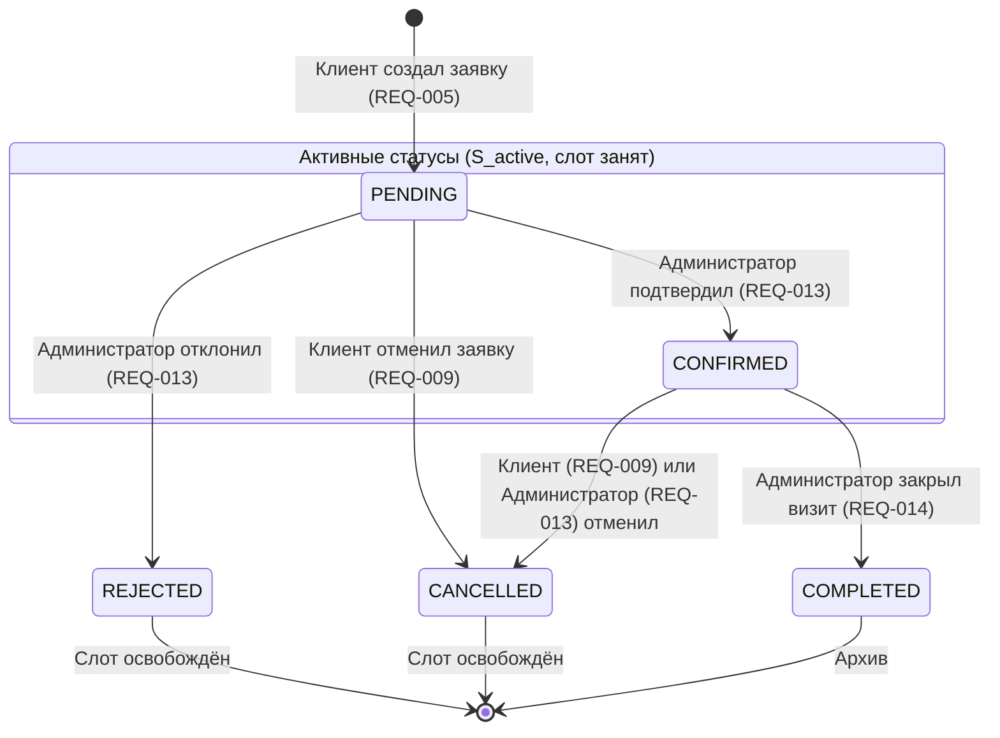

# Спецификация требований — Сервис онлайн-записи на услуги

- Case ID: `service-booking`
- Версия: `1.0.0`
- Статус: `APPROVED`
- Дата: `2026-11-03`
- Владелец утверждения: `Product Owner`
- Архитектурный профиль: `FULL_STACK` (Kotlin Backend + Web Frontend)

---

## 1. Резюме

Продукт представляет собой full-stack web-сервис онлайн-записи на услуги для одного заведения (Single-tenant). Сервис позволяет гостям и клиентам выбирать услуги, просматривать график свободных слотов специалистов (мастеров), регистрироваться и отправлять заявки на бронирование. Каждая заявка создаётся со статусом ожидания подтверждения (`PENDING`), надёжно удерживая слот на стороне бэкенда от повторного бронирования (овербукинга). Администратор через выделенный Web-интерфейс управляет каталогом услуг, мастерами, расписанием и выполняет модерацию заявок: подтверждает (`CONFIRMED`), отклоняет (`REJECTED`), отменяет подтверждённые визиты (`CANCELLED`) или фиксирует их завершение (`COMPLETED`).

---

## 2. Цели и метрики успеха

| ID | Цель | Метрика | Целевое значение | Источник / статус |
|---|---|---|---|---|
| `GOAL-001` | Обеспечить клиентам удобный самостоятельный выбор услуги и запись через веб-интерфейс 24/7. | Время оформления заявки клиентом от выбора слота до подтверждения. | $\le 2$ минут | `01-intake.md` / **CONFIRMED** |
| `GOAL-002` | Исключить конфликты расписания и двойные бронирования к одному специалисту на одно время. | Количество инцидентов двойного бронирования (овербукинга) в системе. | 0 инцидентов (100% защита инварианта) | `01-intake.md`, п. 4 / **CONFIRMED** |
| `GOAL-003` | Предоставить администратору заведения полный контроль над каталогом, графиком мастеров и модерацией заявок. | Возможность выполнения всех операций настройки и модерации через Web UI без обращения к разработчикам. | 100% административных сценариев доступны в UI | `DEC-004` / **CONFIRMED** |

---

## 3. Акторы и роли

| ID | Роль | Описание | Права и ограничения |
|---|---|---|---|
| `ACTOR-001` | **Гость (Guest)** | Неавторизованный посетитель сайта. | Просмотр каталога услуг, карточек специалистов и расписания свободных слотов. При попытке бронирования перенаправляется на форму входа/регистрации. |
| `ACTOR-002` | **Клиент (Client)** | Авторизованный пользователь сервиса. | Просмотр услуг и слотов, создание заявки на бронирование (`PENDING`), доступ к Личному кабинету, просмотр статусов своих заявок, отмена активных заявок (`CANCELLED`), завершение сеанса (Logout). Не имеет доступа к данным других клиентов и админ-панели. |
| `ACTOR-003` | **Администратор (Admin)** | Авторизованный сотрудник заведения с расширенными правами. | Управление услугами (CRUD), управление мастерами (CRUD), настройка рабочего расписания мастеров, просмотр всех заявок, подтверждение (`CONFIRMED`), отклонение (`REJECTED`), отмена подтверждённых записей (`CANCELLED`), завершение визитов (`COMPLETED`), завершение сеанса (Logout). |

---

## 4. Scope

### MVP (Входит в релиз)
1. Регистрация, аутентификация и завершение сеанса (Logout) по паре Email + Пароль (с солевым хэшированием).
2. Каталог услуг (название, описание, длительность 30/60 мин, стоимость).
3. Список мастеров и привязка услуг к мастерам.
4. Настройка рабочего графика мастеров администратором (рабочие дни недели, часы работы).
5. Расчёт и отображение дискретной сетки свободных слотов для выбранного мастера и услуги.
6. Оформление заявки на бронирование клиентом со статусом `PENDING`.
7. Гарантированная защита от двойного бронирования на бэкенде при конкурентных запросах.
8. Личный кабинет клиента (список активных заявок, история, возможность отмены записи).
9. Панель администратора (Web UI) для управления услугами, мастерами, расписанием и модерации заявок.
10. Адаптивная верстка клиентской и административной части для мобильных и десктопных браузеров.

### После MVP (Post-MVP)
- Уведомления клиентов по SMS и мессенджерам (Telegram/WhatsApp).
- Автоматический таймаут (TTL) отмены нерассмотренных заявок в статусе `PENDING`.
- Синхронизация расписания мастеров с Google Calendar / Apple Calendar.
- Многофилиальность (Multi-tenancy) и выбор локаций.
- Учёт кабинетов и специализированного оборудования как отдельных бронируемых ресурсов.

### Out of Scope (Строго исключено из текущего кейса)
- Native Android и iOS мобильные приложения (`DEC-001`).
- Онлайн-эквайринг, предоплата, депозиты и фискализация (`DEC-008`).
- Интеграция с внешними CRM и складскими программами (`DEC-008`).
- Автоматический CI/CD pipeline и облачная инфраструктура (достаточны локальный запуск и тесты).

---

## 5. Термины

| Термин | Определение |
|---|---|
| **Мастер (Специалист)** | Сотрудник заведения, оказывающий услуги. Является неделимым бронируемым ресурсом $R$. |
| **Услуга** | Сервисная операция фиксированной длительности ($Duration$) и стоимости, оказываемая мастером. |
| **Временной слот** | Полуинтервал времени $[T_{start}, T_{end})$, где $T_{end} = T_{start} + Duration$, на который может быть оформлена ровно одна заявка. |
| **Двойное бронирование (Overbooking)** | Ошибочное состояние системы, при котором на один ресурс $R$ на пересекающиеся интервалы времени созданы две активные записи. |
| **Активный статус бронирования** | Статус, при котором ресурс считается занятым: $S_{active} = \{ \text{PENDING}, \text{CONFIRMED} \}$. |

---

## 6. Функциональные требования

| ID | Формулировка требования | Приоритет | Сценарий | Источник | Статус |
|---|---|---|---|---|---|
| `REQ-001` | Система должна позволять гостю зарегистрироваться, указав уникальный email, пароль ($\ge 8$ символов), имя и контактный телефон. | Must | `SCN-001` | `FACT-002`, `DEC-007` | **CONFIRMED** |
| `REQ-002` | Система должна аутентифицировать пользователя по email и паролю с выдачей токена/сессии по роли (`Client` или `Admin`), а также обеспечивать безопасный выход (Logout) с инвалидацией сессии в Web UI. | Must | `SCN-001` | `FACT-002`, `DEC-007`, `AUD-008` | **CONFIRMED** |
| `REQ-003` | Система должна предоставлять каталог активных услуг с отображением названия, описания, длительности и цены. | Must | `SCN-002` | `DEC-004` | **CONFIRMED** |
| `REQ-004` | Система должна динамически рассчитывать и отображать доступные свободные слоты для выбранного мастера на выбранную дату с учётом его графика работы и исключения занятых слотов в статусах $S_{active}$. | Must | `SCN-002` | `DEC-003`, `DEC-006` | **CONFIRMED** |
| `REQ-005` | Система должна позволять авторизованному клиенту создавать заявку на бронирование свободного слота со статусом `PENDING`. | Must | `SCN-002` | `FACT-004`, `DEC-005` | **CONFIRMED** |
| `REQ-006` | Серверный бэкенд обязан обеспечивать атомарную защиту от двойного бронирования: блокировать создание бронирования к мастеру, если на данный интервал уже существует запись в статусе из $S_{active} = \{ \text{PENDING}, \text{CONFIRMED} \}$. | Must | `SCN-003` | `FACT-005`, `FACT-006` | **CONFIRMED** |
| `REQ-007` | При конкурентной попытке занять один и тот же слот бэкенд обязан вернуть второму запросу HTTP `409 Conflict` (`SLOT_ALREADY_BOOKED`), а Web UI — отобразить понятное сообщение и сделать слот недоступным. | Must | `SCN-003` | `FACT-006`, `02-open-questions.md` | **CONFIRMED** |
| `REQ-008` | Личный кабинет клиента должен отображать список его бронирований, разделённый на активные (`PENDING`, `CONFIRMED`) и архивные (`COMPLETED`, `CANCELLED`, `REJECTED`), с указанием мастера, услуги, даты, времени и статуса. | Must | `SCN-004` | `FACT-003` | **CONFIRMED** |
| `REQ-009` | Клиент должен иметь возможность отменить свою заявку/запись в статусе `PENDING` или `CONFIRMED` через Личный кабинет до наступления времени услуги, переводя её в статус `CANCELLED`. | Must | `SCN-004` | `DEC-005` | **CONFIRMED** |
| `REQ-010` | Web UI Администратора должен обеспечивать CRUD-управление услугами (создание, редактирование названия/цены/длительности, мягкое удаление/деактивация). | Must | `SCN-005` | `DEC-004` | **CONFIRMED** |
| `REQ-011` | Web UI Администратора должен обеспечивать CRUD-управление профилями мастеров и привязку услуг, которые оказывает мастер. | Must | `SCN-005` | `DEC-004` | **CONFIRMED** |
| `REQ-012` | Web UI Администратора должен позволять настраивать рабочее расписание для каждого мастера (рабочие дни недели, рабочие интервалы дня $Start < End$). | Must | `SCN-005` | `DEC-004` | **CONFIRMED** |
| `REQ-013` | Web UI Администратора должен отображать реестр входящих заявок и предоставлять действия: «Подтвердить» (`PENDING` $\to$ `CONFIRMED`), «Отклонить» (`PENDING` $\to$ `REJECTED`) и «Отменить запись» (`CONFIRMED` $\to$ `CANCELLED`) с немедленным высвобождением слота. | Must | `SCN-005` | `DEC-004`, `DEC-005`, `AUD-003` | **CONFIRMED** |
| `REQ-014` | Web UI Администратора должен позволять переводить подтверждённую запись в статус `COMPLETED` по факту оказания услуги. | Must | `SCN-005` | `DEC-005`, `AUD-001` | **CONFIRMED** |

---

## 7. Нефункциональные требования

| ID | Категория | Требование и измеримый критерий | Приоритет | Источник | Статус |
|---|---|---|---|---|---|
| `NFR-001` | Data Integrity / Concurrency | Backend обязан гарантировать строгую изоляцию транзакций при создании бронирования. При одновременной отправке $\ge 20$ параллельных запросов на один слот создаётся ровно 1 бронирование в статусе `PENDING`, все остальные запросы получают HTTP 409. | Must | `FACT-005`, `FACT-006` | **CONFIRMED** |
| `NFR-002` | Platform Scope | Профиль системы — `FULL_STACK` (Kotlin Backend + Web Frontend). Native Android мобильное приложение исключено из скоупа. | Must | Запрос, `DEC-001` | **CONFIRMED** |
| `NFR-003` | Usability & Responsiveness | Клиентский и административный Web UI должны корректно отображаться и функционировать на мобильных экранах (от 360px) и десктопах в браузерах Chrome, Safari, Firefox. | Must | `02-open-questions.md`, Q-022 | **CONFIRMED** |
| `NFR-004` | Security | Пароли пользователей должны храниться в БД в захэшированном виде с использованием стойких криптографических алгоритмов (Argon2id или BCrypt с солью). Доступ к административным эндпоинтам защищён RBAC. | Must | Требования безопасности | **CONFIRMED** |
| `NFR-005` | Timezone & Date | Все метки времени в базе данных и API должны храниться и передаваться в формате ISO-8601 UTC. Клиенту и администратору время отображается в локальной таймзоне заведения. | Must | `RISK-002`, `AUD-007` | **CONFIRMED** |
| `NFR-006` | Performance | Время генерации сетки слотов на бэкенде должно составлять $\le 300$ мс (p95) при одновременной работе до 50 пользователей. | Must | `02-open-questions.md`, Q-023, `AUD-007` | **CONFIRMED** |

---

## 8. Бизнес-правила и валидации

- `BR-001` (Интервал слота): Интервал времени бронирования рассчитывается как полуинтервал $[T_{start}, T_{end})$, где $T_{end} = T_{start} + Duration(Service)$. Смежные слоты (например, 10:00–11:00 и 11:00–12:00) не считаются пересекающимися.
- `BR-002` (Блокировка слота при заявке): Заявка в статусе `PENDING` является блокирующей (входит в $S_{active}$). Слот не может быть предложен другому клиенту, пока заявка не отклонена или не отменена.
- `BR-003` (Освобождение слота): При переводе записи в статус `REJECTED` (отклонено админом) или `CANCELLED` (отменено клиентом или админом) слот немедленно становится доступным в расписании мастера для других клиентов.
- `BR-004` (Регламент отмены): Клиент может отменить запись в статусе `PENDING` или `CONFIRMED` только до наступления момента $T_{start}$. Отмена прошедших или уже завершённых записей запрещена.
- `BR-005` (Валидация регистрации): Email должен соответствовать формату RFC 5322 и быть уникальным в системе. Длина пароля — не менее 8 символов. Телефон — от 10 до 15 цифр.
- `BR-006` (Запрет бронирования в прошлом): Запрещено создание заявки на временной интервал в прошлом ($T_{start} \le T_{now}$ относительно локального времени заведения).

---

## 9. Данные и жизненный цикл

### Сущности системы
1. **User (Пользователь):** `id`, `email`, `password_hash`, `role` (`CLIENT`, `ADMIN`), `name`, `phone`, `created_at`.
2. **Master (Мастер):** `id`, `name`, `description`, `is_active`.
3. **Service (Услуга):** `id`, `name`, `description`, `duration_minutes` (30/60 мин), `price`, `is_active`.
4. **MasterService:** связь мастера и оказываемых услуг (Many-to-Many).
5. **MasterSchedule (Расписание):** `id`, `master_id`, `day_of_week` (1..7), `start_time`, `end_time`.
6. **Booking (Бронирование):** `id`, `client_id`, `master_id`, `service_id`, `start_time` (UTC), `end_time` (UTC), `status`, `created_at`, `updated_at`.

### Жизненный цикл статусов бронирования

---

## 10. Интеграции

- **Внешние интеграции:** В рамках MVP внешние интеграции отсутствуют (`OUT OF SCOPE` согласно `DEC-008`). Оповещения клиентов и администратора происходят через интерфейс системы.

---

## 11. Ограничения и допущения

- `ASM-001`: Сервис обслуживает одну локацию (Single-tenant).
- `ASM-002`: Бронируемым ресурсом является специалист. Учёт физических кабинетов вынесен за рамки MVP.
- `ASM-003`: Заявка удерживает слот в статусе `PENDING` до ручного решения администратора или отмены клиентом (авто-TTL таймер вынесен в Post-MVP).
- `ASM-004`: Для запуска MVP требуется базовый Web UI администратора (создание услуг, мастеров, расписания, модерация заявок).
- `ASM-005`: Регистрация и аутентификация клиентов выполняется по паре Email + Пароль (без платных SMS-шлюзов).
- `ASM-006`: Все операции привязаны к единому часовому поясу заведения.
- `ASM-007`: Начальный администратор для локального стенда инициализируется через миграцию/сид БД с учётными данными по умолчанию из переменных окружения.

---

## 12. Открытые вопросы

- Все 25 исходных вопросов закрыты решениями `DEC-001` – `DEC-008`. Блокирующих вопросов нет.

---

## 13. Критерии приёмки

Критерии приёмки формализованы в документе [`05-acceptance-matrix.md`](file:///Users/sunmoonsuz/analysis-project/cases/service-booking/05-acceptance-matrix.md).

---

## 14. Трассируемость (Traceability Matrix)

| Goal | Scenario | Requirement | Acceptance Criterion | Test Type |
|---|---|---|---|---|
| `GOAL-001` | `SCN-001` | `REQ-001`, `REQ-002` | `AC-001`, `AC-008` | E2E / Integration / Security |
| `GOAL-001` | `SCN-002` | `REQ-003`, `REQ-004`, `REQ-005` | `AC-002`, `AC-EDGE-008` | E2E / Integration |
| `GOAL-002` | `SCN-003` | `REQ-006`, `REQ-007`, `NFR-001` | `AC-003`, `AC-004`, `AC-EDGE-001`, `AC-EDGE-002` | Concurrency Automated Test |
| `GOAL-001` | `SCN-004` | `REQ-008`, `REQ-009` | `AC-005`, `AC-EDGE-005` | E2E / UI |
| `GOAL-003` | `SCN-005` | `REQ-010`, `REQ-011`, `REQ-012`, `REQ-013` | `AC-006`, `AC-007`, `AC-EDGE-006`, `AC-EDGE-007` | E2E / Integration |
| `GOAL-003` | `SCN-005` | `REQ-014` | `AC-009` | E2E / Integration |
| `GOAL-001` | `SCN-001`..`SCN-005` | `NFR-002`, `NFR-003` | `AC-004` | UI / Cross-browser Test |
| `GOAL-001` | `SCN-001`, `SCN-005` | `NFR-004` | `AC-001`, `AC-008` | Security Integration Test |
| `GOAL-002` | `SCN-002`, `SCN-003` | `NFR-005` | `AC-010` | Automated Timezone Test |
| `GOAL-001` | `SCN-002` | `NFR-006` | `AC-011` | Automated Performance Test |

---

## 15. История изменений

| Версия | Дата | Изменение | Автор | Утверждение |
|---|---|---|---|---|
| `0.1.0-draft` | 2026-11-03 | Первичная структура шаблона спецификации | Requirements Analyst | DRAFT |
| `0.2.0-draft` | 2026-11-03 | Включение подтверждённых решений PO: Single-tenant, Master ресурс, роль Администратора в MVP, модерация заявок (`PENDING`), инвариант двойного бронирования | Lead Analyst | IN_REVIEW |
| `0.3.0-draft` | 2026-11-03 | Устранение замечаний независимого аудита (`AUD-001`–`AUD-010`): исключен фантомный статус `IN_PROGRESS`, приоритет `REQ-014` повышен до Must, добавлена отмена записи администратором (`REQ-013`), запрет бронирования в прошлом (`BR-006`), функция Logout (`REQ-002`), полная матрица трассируемости NFR и AC | Lead Analyst | IN_REVIEW |
| `1.0.0` | 2026-11-03 | Финальное утверждение спецификации владельцем продукта (APPROVED) | Product Owner | APPROVED |
